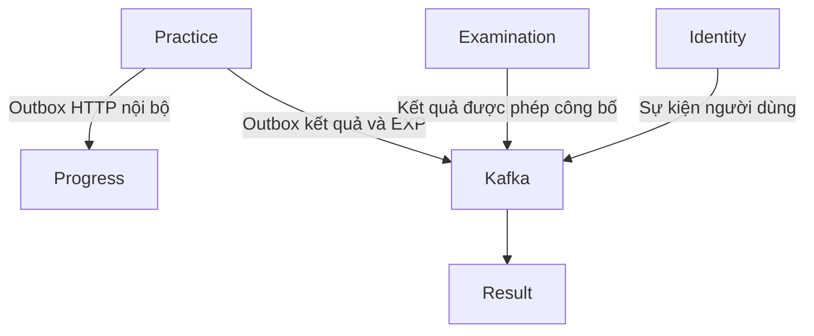

# DTS — Tổng quan dự án, nghiệp vụ và hướng dẫn chạy local
  
**Môi trường minh họa:** Windows, PowerShell, source tại `D:\DTS`, backend Java chạy trên Windows, hạ tầng PostgreSQL/Redis/Kafka chạy bằng Docker.

Tài liệu mô tả chức năng, nghiệp vụ, trách nhiệm từng repository, các luồng dữ liệu và cách khởi động dự án. Các thông tin được tổng hợp từ source đã đọc và quá trình tích hợp local trong cuộc trao đổi. Mật khẩu, JWT secret, khóa nội bộ, SMTP và credential MinIO cần nhận qua kênh cấu hình của nhóm.

Các đoạn có `<...>` là chỗ phải thay bằng cấu hình thực tế. Các lệnh sử dụng đường dẫn `D:\DTS`; nếu đặt source ở nơi khác, thay đường dẫn tương ứng.

## Mục lục

1. [Tổng quan dự án](#1-tổng-quan-dự-án)
2. [Chức năng và nghiệp vụ của từng repository](#2-chức-năng-và-nghiệp-vụ-của-từng-repository)
3. [Chuẩn bị môi trường và cách chạy từng repository](#3-chuẩn-bị-môi-trường-và-cách-chạy-từng-repository)

---

# 1. Tổng quan dự án

## 1.1. Mục tiêu của hệ thống

DTS là hệ thống học tập, ôn luyện và thi lý thuyết giấy phép lái xe. Hệ thống phục vụ học viên trong quá trình học câu hỏi, ôn kiến thức, thi thử và tham gia các kỳ thi chính thức; đồng thời cung cấp công cụ cho quản trị viên quản lý nội dung, người dùng và tổ chức thi.

### Học viên

- Đăng ký, đăng nhập và quản lý hồ sơ cá nhân.
- Chọn hạng GPLX đang học.
- Học câu hỏi theo chương, xem giải thích và lưu vị trí học.
- Ôn câu sai và câu điểm liệt.
- Thi thử ngẫu nhiên hoặc theo bộ đề có sẵn.
- Xem và tham gia kỳ thi chính thức theo điều kiện cho phép.
- Đọc lịch sử, kết quả, tiến độ học tập, thống kê và xếp hạng.
- Tra cứu biển báo và mẹo ghi nhớ.

### Quản trị viên

- Quản lý người dùng, vai trò và quyền.
- Quản lý câu hỏi, đáp án, chương và chương trình học.
- Tra cứu ngân hàng câu hỏi chuẩn theo hạng GPLX và phiên bản.
- Quản lý cấu trúc đề, tiêu chí chấm và quy chế thi.
- Tạo, quản lý và công bố các phiên bản kỳ thi.
- Thực hiện công bố kết quả khi quy chế yêu cầu quản trị viên quyết định.
- Quản lý file và nội dung ảnh thông qua luồng Media.

## 1.2. Danh sách repository và trách nhiệm

Tên `dts-system-fontend` được giữ nguyên theo tên repo hiện tại.

| Repository | Trách nhiệm chính | Công nghệ/build | Cổng local đang dùng |
|---|---|---|---:|
| `dts-system-fontend` | Giao diện học viên và quản trị viên | Next.js, React, TypeScript, npm | 3000 |
| `dts-gateway` | Cổng định tuyến API | Spring Cloud Gateway, Maven | 8888 |
| `dts-identity` | Tài khoản, xác thực, hồ sơ, vai trò và quyền | Spring Boot, Maven | 8081 |
| `dts-content-builder` | Nội dung học tập, câu hỏi, chương và chương trình | Spring Boot, Gradle | 8082 |
| `dts-progress` | Tổng hợp tiến độ học tập | Spring Boot, Maven | 8083 |
| `dts-result` | Lịch sử hợp nhất, dữ liệu kết quả tổng hợp, EXP và analytics | Spring Boot, Maven | 8086 |
| `dts-practice` | Học câu hỏi, ôn luyện và thi thử | Spring Boot, Maven | 8087 |
| `dts-examination` | Cấu hình, tổ chức và xử lý thi chính thức | Spring Boot, Gradle | 8088 |
| `dts-media` | Metadata file, upload và URL đọc file | Spring Boot, Gradle | 8080 |

Mỗi backend có trách nhiệm dữ liệu riêng. Một chức năng trên giao diện có thể cần nhiều service cùng hoạt động.

Ví dụ: trang câu hỏi có thể đọc nội dung từ Content Builder và lấy URL ảnh từ Media. Nội dung câu hỏi tải được nhưng ảnh chưa hiện là hai bước xử lý khác nhau.

## 1.3. Công nghệ và hạ tầng

| Thành phần | Vai trò trong hệ thống |
|---|---|
| JDK 21, Spring Boot | Chạy các backend Java |
| Next.js, React, TypeScript | Xây dựng giao diện web |
| PostgreSQL | Lưu dữ liệu nghiệp vụ của các service |
| Redis | Phục vụ nhu cầu cache/phiên/kiểm soát truy cập theo cấu hình từng service |
| Kafka | Truyền sự kiện giữa các service |
| ZooKeeper | Thành phần của cụm Kafka local đang sử dụng |
| MinIO | Lưu object, ví dụ ảnh và tài liệu |
| SMTP | Gửi email xác minh và khôi phục tài khoản |
| Docker Desktop | Chạy hạ tầng local bằng container |

Môi trường đã sử dụng PostgreSQL 16, Redis 7 và Kafka image `confluentinc/cp-kafka:7.6.0`. Thành viên mới nên dùng cấu hình hạ tầng được nhóm thống nhất để giữ tương thích.

## 1.4. Nguyên tắc sở hữu dữ liệu

| Dữ liệu/nghiệp vụ | Service sở hữu |
|---|---|
| Danh tính, hồ sơ, hạng GPLX đã chọn, role và permission | Identity |
| Nội dung biên soạn, cấu trúc nội dung và nguồn câu hỏi phục vụ thi chính thức | Content Builder |
| Phiên học/ôn/thi thử, đáp án và kết quả thi thử | Practice |
| Kỳ thi chính thức, phiên bản đề, phiên thi, đáp án, chấm và công bố | Examination |
| Dữ liệu tổng hợp tiến độ học tập | Progress |
| Bản ghi phục vụ lịch sử hợp nhất, xếp hạng và thống kê | Result |
| Metadata file và luồng truy cập nơi lưu file | Media |

Service gọi API hoặc nhận sự kiện để trao đổi dữ liệu. Khi viết chức năng mới, phải xác định service chịu trách nhiệm cho dữ liệu đó; tránh tạo một bản dữ liệu độc lập ở frontend hoặc cập nhật trực tiếp database của service khác.

## 1.5. Đường đi của request web

Frontend sử dụng các đường dẫn API cùng origin. Khi chạy local:

1. Trình duyệt gọi Next.js tại `http://localhost:3000`.
2. Next.js chuyển request API đến Gateway tại `http://localhost:8888`.
3. Gateway chọn service và viết lại đường dẫn theo route.
4. Backend kiểm tra đầu vào, xác thực/quyền và thực hiện nghiệp vụ.
5. Response đi ngược về giao diện.

| Đường dẫn phía web/Gateway | Service đích | Đường dẫn tại service |
|---|---|---|
| `/api/identity/v1/...` | Identity | `/api/v1/...` |
| `/api/practice/v1/...` | Practice | `/api/v1/...` |
| `/api/progress/v1/...` | Progress | `/api/v1/...` |
| `/api/content-builder/v1/...` | Content Builder | `/api/v1/content-builder/...` |
| `/api/examination/v1/...` | Examination | `/api/v1/...` |
| `/api/result/v1/...` | Result | `/v1/...` |
| `/api/v1/media/...` | Media | `/api/v1/media/...` |

Identity và Practice còn có một số route tương thích được cấu hình tại Gateway. Khi phát triển chức năng mới, dùng API client và đường dẫn đã được thống nhất trong repo.

**Điểm cần nhớ:** Result hiện không có prefix `/api` tại controller của các endpoint `/v1/...`. Prefix public `/api/result` được Gateway loại bỏ khi chuyển tiếp.

## 1.6. Luồng đồng bộ và ý nghĩa outbox



Sơ đồ trên tập trung vào các luồng chính phục vụ tiến độ, lịch sử và tổng hợp kết quả. Các service còn có những cuộc gọi trực tiếp phục vụ đọc hồ sơ, danh mục ngân hàng và nội dung câu hỏi.

**Outbox** là bản ghi sự kiện chờ gửi nằm trong database của service nguồn. Ví dụ khi kết thúc bài thi thử, Practice có thể lưu kết quả và sự kiện cần đồng bộ trong cùng transaction. Worker sau đó gửi sự kiện sang Progress hoặc Kafka.

Cách làm này giúp giữ kết quả đã lưu khi bên nhận tạm thời chưa sẵn sàng. Worker tiếp tục gửi lại các sự kiện còn chờ. Phía nhận sử dụng định danh và quy tắc xử lý lặp để tránh tạo nhiều bản kết quả hoặc cộng điểm nhiều lần cho cùng bằng chứng.

Dữ liệu nguồn có thể đã được lưu trước khi các màn hình tổng hợp nhận được dữ liệu mới. Vì vậy, cần phân biệt trạng thái hoàn thành bài với trạng thái đã đồng bộ lịch sử/thống kê.

## 1.7. Các khái niệm dùng chung

| Khái niệm | Ý nghĩa |
|---|---|
| Hạng GPLX | Hạng giấy phép mà người dùng lựa chọn và chức năng đang xử lý |
| `selectedLicenseClass` | Hạng hiện tại do Identity lưu trong hồ sơ người dùng |
| `bankVersion` | Phiên bản ngân hàng câu hỏi; dùng để giữ đúng nguồn dữ liệu và tiến độ |
| `sourceId` | ID phiên/bản ghi gốc ở service nguồn |
| `resultId` | ID bản ghi tại Result; có thể khác `sourceId` |
| `targetId` | Đối tượng bài/đề mà kết quả tham chiếu |
| `examVersionId` | Phiên bản kỳ thi chính thức |
| Snapshot | Dữ liệu được lưu tại một thời điểm để giữ ngữ cảnh nghiệp vụ của bài/phiên |
| Receipt | Bản ghi xác nhận một nghiệp vụ hoặc sự kiện đã được ghi nhận |
| Outbox | Bản ghi sự kiện cần chuyển sang hệ thống khác |
| Migration | File thay đổi database có phiên bản và được quản lý cùng source |

---

# 2. Chức năng và nghiệp vụ của từng repository

## 2.1. `dts-system-fontend` — Giao diện web

### 2.1.1. Vai trò

Frontend cung cấp các màn hình cho học viên và quản trị viên, quản lý trạng thái giao diện và gọi backend theo contract.

Backend là nơi xác định điểm, điều kiện đạt, quyền truy cập, cấu hình đề thi, EXP và thứ hạng. Frontend hiển thị các kết quả được trả về và xử lý tương tác của người dùng.

### 2.1.2. Chức năng phía học viên

| Chức năng | Nghiệp vụ trên giao diện | Backend liên quan |
|---|---|---|
| Đăng ký, đăng nhập | Nhập thông tin tài khoản, nhận và sử dụng phiên đăng nhập | Identity |
| Xác minh, khôi phục mật khẩu | Thực hiện các bước nhận/gửi thông tin xác minh, đặt lại mật khẩu | Identity |
| Hồ sơ | Đọc, cập nhật thông tin, chọn hạng GPLX | Identity |
| Học theo chương | Đọc câu hỏi, đáp án, giải thích; lưu câu đã học và vị trí hiện tại | Practice, Progress |
| Câu điểm liệt | Học và ôn nhóm câu điểm liệt, hiển thị tiến độ | Practice, Progress |
| Ôn câu sai | Đọc danh sách cần ôn và thực hiện vòng ôn | Practice, Progress |
| Thi thử | Chọn chế độ, tạo phiên, làm bài, kết thúc và xem kết quả | Practice |
| Thi chính thức | Đọc danh sách/chi tiết kỳ thi, làm bài và xem kết quả được phép công bố | Examination |
| Lịch sử thi | Lọc lịch sử hợp nhất, phân trang và mở bài nguồn | Result, Practice, Examination |
| Tiến độ | Hiển thị tổng quan, tiến độ chương, câu cần ôn và câu điểm liệt | Progress |
| Xếp hạng | Hiển thị bảng xếp hạng và vị trí của tài khoản | Result |
| Thống kê kết quả | Hiển thị KPI, xu hướng theo ngày và bài gần đây | Result |
| Biển báo, mẹo ghi nhớ | Tra cứu nội dung đã công bố | Practice |
| Hiển thị file/ảnh | Lấy URL media và hiển thị file | Media, MinIO |

### 2.1.3. Chức năng phía quản trị

- Ngân hàng câu hỏi chuẩn theo hạng và phiên bản.
- Câu hỏi tự biên soạn và các lựa chọn trả lời.
- Chương ngân hàng và chương tự biên soạn.
- Chương trình học và các khối chương.
- Cấu trúc đề, tiêu chí chấm và quy chế thi.
- Kỳ thi và phiên bản đề.
- Người dùng, vai trò và quyền.

Một trang quản trị có thể đọc nội dung từ Content Builder, hiển thị ảnh từ Media và gửi cấu hình thi sang Examination. Quyền trên từng API vẫn do backend liên quan kiểm tra.

### 2.1.4. Quy tắc tích hợp dữ liệu

- Hạng đang chọn đọc từ Identity; các màn hình đổi hạng phải cập nhật dữ liệu theo scope mới.
- Số câu, thời gian, điều kiện đạt và câu điểm liệt lấy từ backend nghiệp vụ.
- Dữ liệu cá nhân trong cache phải có người dùng và hạng phù hợp trong query key.
- Các bộ lọc và thời gian cũng phải tham gia query key khi làm thay đổi dữ liệu trả về.
- Phân trang và thứ hạng sử dụng dữ liệu backend; frontend không tự xếp lại một trang rồi coi đó là thứ hạng toàn bộ.
- Giá trị `0`, `null`, danh sách rỗng và trạng thái chưa sẵn sàng có ý nghĩa khác nhau.
- API client hiện có xử lý response; cần đọc kiểu trả về của client trước khi thêm `.data` vào nơi sử dụng.

Với Analytics, `SOURCE_POLICY_PENDING` vẫn là response nghiệp vụ hợp lệ. Điểm chuẩn hóa có thể là `null`, còn số lượt hoặc các chỉ số nguồn vẫn có thể hiển thị.

### 2.1.5. Tên bài chính thức cũ và điều hướng

Một số bản ghi lịch sử cũ chưa có `displayTitle` hoặc `title`. Phần hiển thị có thể đọc tên bổ sung từ API Examination sau khi đối chiếu bản ghi lịch sử thuộc tài khoản, loại nguồn, hạng và phiên bản khi có.

Tên bổ sung này chỉ phục vụ giao diện. Snapshot lịch sử, điểm và kết quả nguồn được giữ nguyên. Nếu không đọc được tên, giao diện giữ placeholder phù hợp và vẫn hiển thị phần dữ liệu còn lại.

Khi mở kết quả, cần phân biệt `resultId` của Result với ID phiên nguồn. Dùng tham chiếu `sourceResult` và đường dẫn đúng loại bài.

### 2.1.6. Cấu trúc source nên đọc

| Thư mục | Nội dung |
|---|---|
| `src/app` | Route, page và layout |
| `src/features` | Chức năng chia theo nghiệp vụ |
| `src/components` | Component dùng chung |
| `src/lib/api` | Client HTTP, cấu hình prefix và xử lý response |
| `src/stores` | Trạng thái dùng chung, gồm đăng nhập và hồ sơ |

Khi sửa màn hình, ưu tiên mở feature tương ứng, service gọi API, hook lấy dữ liệu và component hiển thị trước khi thay đổi client hoặc store dùng chung.

## 2.2. `dts-gateway` — Cổng API

### 2.2.1. Vai trò

Gateway nhận request API từ web và định tuyến đến backend phù hợp. Cấu hình local phải chỉ đúng địa chỉ nơi các backend đang chạy.

### 2.2.2. Chức năng

| Chức năng | Nghiệp vụ kỹ thuật |
|---|---|
| Route | Chọn service dựa trên prefix request |
| Rewrite | Chuyển đường dẫn public sang đường dẫn controller của service |
| Theo dõi request | Gắn mã request để đối chiếu log |
| Xử lý lỗi chuyển tiếp | Trả lỗi chuẩn khi việc chuyển tiếp không thành công |
| Giới hạn proxy Result | Giới hạn phần đường dẫn Result được công khai |

Xác thực, role/permission và quyền sở hữu dữ liệu được thực thi tại các API backend tương ứng.

### 2.2.3. Đặc điểm khi chạy local

Với backend Java chạy trên Windows, các đích local trong tài liệu dùng `http://localhost:<port>`.

Hostname như `examination`, `dts-progress` hoặc `dts-media` phụ thuộc môi trường mạng đã cấu hình. Việc dùng được hostname trong mạng Docker không tự bảo đảm tiến trình Java trên Windows cũng truy cập được.

Khi thay biến môi trường, phải khởi động lại tiến trình Gateway từ terminal đã nạp biến mới. Đặt biến ở một PowerShell khác không thay đổi cấu hình của tiến trình đang chạy.

## 2.3. `dts-identity` — Tài khoản, hồ sơ và phân quyền

### 2.3.1. Vai trò

Identity lưu danh tính người dùng và cung cấp các nghiệp vụ xác thực, hồ sơ, lựa chọn hạng và phân quyền.

### 2.3.2. Chức năng và nghiệp vụ

| Chức năng | Nội dung nghiệp vụ |
|---|---|
| Đăng ký | Kiểm tra dữ liệu đầu vào và tạo tài khoản theo quy định |
| Đăng nhập | Kiểm tra thông tin tài khoản, trạng thái và cấp token |
| Refresh | Tiếp nhận refresh token hợp lệ để cấp phiên truy cập tiếp theo |
| Đăng xuất | Xử lý kết thúc phiên theo cơ chế quản lý token |
| Xác minh email | Tiếp nhận thông tin xác minh và cập nhật trạng thái tương ứng |
| Đổi mật khẩu | Kiểm tra mật khẩu hiện tại và điều kiện mật khẩu mới |
| Quên/đặt lại mật khẩu | Quản lý yêu cầu khôi phục và cập nhật mật khẩu khi hợp lệ |
| Hồ sơ cá nhân | Đọc và cập nhật các trường được cho phép |
| Hạng GPLX | Lưu hạng đang chọn trong `selectedLicenseClass` |
| Quản trị tài khoản | Tạo, đọc, cập nhật trạng thái và quản lý người dùng |
| Role | Quản lý vai trò và gán/bỏ vai trò cho tài khoản |
| Permission | Quản lý quyền và quan hệ quyền của vai trò |
| Sự kiện người dùng | Cung cấp dữ liệu để các service nhận đồng bộ thông tin cần thiết |

### 2.3.3. Luồng đăng nhập và sử dụng hồ sơ

1. Giao diện gửi thông tin đăng nhập đến Identity.
2. Identity xác thực và trả thông tin phiên theo contract.
3. Frontend lưu trạng thái đăng nhập và gửi access token trong các request cần xác thực.
4. Backend nhận request xác định người dùng từ token hợp lệ.
5. Giao diện đọc `/api/v1/users/me` để lấy hồ sơ và hạng GPLX hiện tại.

Hạng do Identity lưu là nguồn để các chức năng kiểm tra điều kiện hoặc chọn scope dữ liệu. Không tự dùng một hạng mặc định trên giao diện khi hồ sơ chưa trả về hạng hợp lệ.

### 2.3.4. Lưu ý nghiệp vụ phân quyền

- Vai trò mô tả nhóm trách nhiệm; permission mô tả các hành động được phép theo từng API.
- Giao diện có thể ẩn thao tác theo quyền, còn backend vẫn phải kiểm tra request.
- Dữ liệu cá nhân được đọc theo người đang đăng nhập.
- Các luồng gửi email cần SMTP tương ứng để hoạt động đầy đủ.

### 2.3.5. Nhóm API để tra cứu source

| Nhóm API trực tiếp | Chức năng |
|---|---|
| `/api/v1/auth/...` | Đăng nhập, đăng ký, refresh, logout, xác minh và mật khẩu |
| `/api/v1/users/me` | Hồ sơ của tài khoản hiện tại |
| `/api/v1/users/me/license` | Hạng GPLX đang chọn |
| `/api/v1/admin/...` | Người dùng, vai trò và quyền quản trị |

## 2.4. `dts-content-builder` — Nội dung và ngân hàng câu hỏi

### 2.4.1. Vai trò

Content Builder quản lý nội dung biên soạn và cung cấp các API nguồn phục vụ việc tra cứu, tổ chức nội dung và cấu hình thi chính thức.

### 2.4.2. Quản lý câu hỏi và đáp án

| Chức năng | Nghiệp vụ |
|---|---|
| Tạo nháp | Lưu câu hỏi đang biên soạn |
| Xuất bản | Kiểm tra điều kiện nội dung trước khi đưa vào trạng thái sử dụng |
| Danh sách/chi tiết | Tra cứu và đọc câu hỏi theo điều kiện |
| Cập nhật | Áp dụng quy tắc chỉnh sửa theo trạng thái câu hỏi |
| Ẩn/lưu trữ/xóa | Xử lý theo trạng thái và quyền của người thực hiện |
| Quản lý lựa chọn | Thêm, sửa, xóa và sắp xếp các đáp án |
| Tham chiếu file | Gắn các media ID cần hiển thị cùng câu hỏi |

Khi công bố câu hỏi, backend kiểm tra tính hợp lệ của đáp án. Ví dụ, câu chọn một đáp án phải có số đáp án đúng phù hợp với loại câu. Nội dung đã xuất bản chịu các giới hạn chỉnh sửa; các thay đổi cần tuân thủ cơ chế phiên bản/trạng thái đang có.

### 2.4.3. Quản lý chương

- Tạo chương nháp hoặc công bố khi đáp ứng điều kiện.
- Gắn câu hỏi vào chương bằng các question block.
- Sắp xếp vị trí các block.
- Đọc nội dung chương và danh sách câu hỏi liên quan.
- Thực hiện cập nhật, ẩn, lưu trữ hoặc xóa theo quy tắc trạng thái.

Một chương muốn công bố phải có nội dung đáp ứng điều kiện. Việc xóa dữ liệu đã được sử dụng phải tuân theo quy tắc của service để giữ các tham chiếu liên quan.

### 2.4.4. Quản lý chương trình học

Chương trình học tổ chức các chương thành một cấu trúc học tập. Các chapter block lưu thứ tự, quan hệ và thông tin các phần của chương trình.

Nghiệp vụ gồm tạo nháp, công bố, cập nhật, đọc cấu trúc và quản lý các block. Điều kiện công bố có kiểm tra nội dung chương trình.

### 2.4.5. Ngân hàng chuẩn và nguồn phục vụ thi chính thức

Giao diện quản trị phân biệt:

- Ngân hàng chuẩn theo hạng GPLX và phiên bản ngân hàng.
- Câu hỏi hoặc chương tự biên soạn.

Các cuộc gọi nguồn phục vụ Examination bao gồm đọc ngân hàng, metadata và chi tiết câu hỏi theo danh sách ID. Examination dùng dữ liệu này để kiểm tra cấu hình và lấy nội dung đề theo đúng nguồn.

Không tự ghép ID câu hỏi giữa Content Builder và Practice bằng số thứ tự. Mỗi nguồn có namespace và thông tin ánh xạ cần được giữ đúng.

### 2.4.6. Nhóm API trực tiếp

| Nhóm API | Chức năng |
|---|---|
| `/api/v1/content-builder/questions` | Câu hỏi |
| `/api/v1/content-builder/questions/{questionId}/options` | Đáp án |
| `/api/v1/content-builder/chapters` | Chương |
| `/api/v1/content-builder/chapters/{chapterId}/question-blocks` | Question block |
| `/api/v1/content-builder/learning-programs` | Chương trình |
| `/api/v1/content-builder/learning-programs/{id}/chapter-blocks` | Chapter block |
| `/api/v1/content-builder/internal/questions/...` | Dữ liệu nguồn phục vụ tích hợp; quyền theo cấu hình API hiện tại |

## 2.5. `dts-practice` — Học, ôn và thi thử

### 2.5.1. Vai trò

Practice lưu hoạt động học và làm bài của học viên trong các chức năng ôn luyện, học câu hỏi và thi thử. Đây là nguồn của đáp án và kết quả thi thử.

### 2.5.2. Danh mục hạng và quy tắc đề

Practice cung cấp catalog hạng GPLX và cấu hình thi theo hạng, gồm số câu, thời gian và điều kiện liên quan.

Frontend đọc cấu hình này trước khi tạo bài. Số câu, thời gian và ngưỡng đạt phải đi cùng quy tắc backend, tránh để các hằng số trên giao diện khác với đề được tạo thật.

### 2.5.3. Thi thử ngẫu nhiên

1. Học viên chọn hạng và chế độ phù hợp.
2. Frontend gửi yêu cầu tạo bài.
3. Backend kiểm tra điều kiện và tạo phiên từ ngân hàng tương ứng.
4. Học viên lưu đáp án, đánh dấu câu và vị trí đang làm.
5. Các thao tác pause/resume được xử lý theo trạng thái và quy tắc phiên.
6. Khi kết thúc, backend chốt kết quả và lưu sự kiện đồng bộ.
7. Học viên mở trang kết quả của phiên vừa hoàn thành.

### 2.5.4. Bộ đề có sẵn

- Đọc các bộ đề đã công bố theo hạng GPLX.
- Chọn một bộ đề để tạo phiên mới.
- Giữ tham chiếu đến bộ đề nguồn để lịch sử và EXP xác định đúng nhóm hoạt động.
- Mỗi lượt làm có kết quả và định danh nguồn riêng.

### 2.5.5. Chế độ luyện tập

Chế độ `PRACTICE` phục vụ việc luyện tập và vẫn có nghiệp vụ đáp án, kết quả/tiến độ theo luồng đã triển khai. Trong luồng lịch sử hợp nhất hiện tại, chế độ này không được ghi thành một lượt thi như `RANDOM_EXAM` hoặc `PRESET_EXAM`.

Một số câu trả lời đúng trong chế độ luyện tập có thể tạo bằng chứng EXP theo quy tắc bằng chứng câu hỏi, độc lập với EXP của lượt thi.

### 2.5.6. Học theo chương

- Đọc danh mục chương thuộc hạng và ngân hàng hiện tại.
- Đọc câu hỏi, lựa chọn và giải thích.
- Gửi lựa chọn để backend xác định kết quả trả lời.
- Lưu trạng thái đã học và dữ liệu cần ôn.
- Lưu vị trí câu đang học để tiếp tục.
- Quản lý bookmark.
- Thực hiện các vòng ôn chương có trạng thái được lưu.

### 2.5.7. Ôn câu sai

Danh sách câu cần ôn được tạo từ dữ liệu nghiệp vụ trả lời. Học viên có thể mở vòng ôn, gửi đáp án, lưu vị trí và kết thúc vòng.

Trạng thái câu cần ôn được quản lý theo quy tắc backend. Giao diện không xóa hoặc coi một câu đã khắc phục chỉ dựa vào trạng thái tạm thời trên trình duyệt.

### 2.5.8. Câu điểm liệt

- Đọc nhóm câu điểm liệt theo hạng.
- Học và gửi đáp án.
- Mở vòng học/ôn và lưu cursor.
- Theo dõi số câu đã học và thông tin cần ôn.

Kết quả đạt/trượt của bài thi phải giữ quy tắc điểm liệt của nguồn. Một bài có số câu đúng cao vẫn có thể trượt khi vi phạm điều kiện này.

### 2.5.9. Nội dung tham khảo và import

| Chức năng | Nghiệp vụ |
|---|---|
| Biển báo | Tra cứu danh sách và chi tiết nội dung đã công bố |
| Mẹo ghi nhớ | Đọc nội dung đã công bố theo thứ tự nguồn |
| Import ngân hàng | Nhập nguồn câu hỏi bằng luồng quản trị |
| Import tham khảo | Nhập biển báo và mẹo ghi nhớ bằng luồng quản trị |

Việc mở thẻ biển báo hoặc nội dung tham khảo không tự tạo bằng chứng trả lời đúng.

### 2.5.10. Đồng bộ dữ liệu

| Luồng | Đích | Phương thức |
|---|---|---|
| Kết quả thi thử thuộc lịch sử | Result | Outbox, Kafka |
| Kết thúc bài và tiến độ câu hỏi | Progress | Outbox, HTTP nội bộ có khóa |
| Bằng chứng EXP và chính sách nguồn | Result | Outbox, Kafka |

Các nghiệp vụ kết thúc lại cùng phiên hoặc gửi lại sự kiện phải giữ kết quả đã chốt và xử lý tính lặp. Nút gửi lại từ giao diện không được dùng để chủ động tạo nhiều kết quả cho cùng một phiên.

### 2.5.11. Nhóm API trực tiếp

| Nhóm API | Chức năng |
|---|---|
| `/api/v1/exams/config` | Cấu hình thi theo hạng |
| `/api/v1/exams/license-catalog` | Catalog hạng |
| `/api/v1/exams/...` | Phiên thi thử, đáp án, kết thúc, kết quả |
| `/api/v1/exams/presets/...` | Bộ đề có sẵn |
| `/api/v1/learning/chapters/...` | Học theo chương và vòng ôn |
| `/api/v1/questions/critical/...` | Câu điểm liệt |
| `/api/v1/questions/wrong/...` và `/api/v1/wrong-questions/sessions/...` | Câu sai và vòng ôn |
| `/api/v1/traffic-signs/...` | Biển báo |
| `/api/v1/memory-tips` | Mẹo ghi nhớ |

## 2.6. `dts-examination` — Thi chính thức

### 2.6.1. Vai trò

Examination quản lý cấu hình và phiên thi chính thức, bao gồm kiểm tra điều kiện tham gia, tạo đề, lưu đáp án, chấm bài và công bố kết quả.

### 2.6.2. Các đối tượng cấu hình

| Đối tượng | Trách nhiệm nghiệp vụ |
|---|---|
| Cấu trúc đề | Xác định phần đề, nguồn, số câu và cách chọn câu |
| Tiêu chí chấm | Xác định cách chấm, tổng điểm và điều kiện đạt |
| Quy chế thi | Quy định thời gian, lượt tham gia, hành vi trong phiên và cách công bố |
| Kỳ thi | Đối tượng quản lý kỳ thi gốc |
| Phiên bản kỳ thi | Cấu hình cụ thể dùng cho công bố và tạo phiên |

Quy chế còn chứa những thiết lập được luồng hiện tại sử dụng như cho phép làm lại, tạm dừng/tiếp tục, điều hướng, xem bài và công bố điểm. Mức áp dụng cụ thể phụ thuộc cấu hình và chức năng đang triển khai trên nhánh.

### 2.6.3. Chọn câu tự động và thủ công

- Chọn tự động: backend chọn câu theo nguồn và các ràng buộc của cấu trúc.
- Chọn thủ công: quản trị viên chọn các câu nguồn cụ thể theo yêu cầu cấu trúc.
- Backend kiểm tra số lượng, nguồn, hạng, phiên bản ngân hàng và điều kiện liên quan trước khi công bố.
- Tùy chọn “Tất cả chương” trên giao diện là cách mở rộng phạm vi lựa chọn; các điều kiện đề vẫn được backend kiểm tra.

### 2.6.4. Quản lý phiên bản

Nghiệp vụ phiên bản gồm tạo, đọc, sửa theo trạng thái, công bố, lưu trữ và sao chép.

Khi công bố, hệ thống kiểm tra cấu hình tham chiếu và dữ liệu nguồn. Phiên thi sử dụng thông tin phiên bản để giữ ngữ cảnh làm bài, thay vì phụ thuộc hoàn toàn vào các chỉnh sửa về sau trên màn hình quản trị.

### 2.6.5. Danh sách và điều kiện tham gia

Học viên xem các nhóm đang mở, sắp diễn ra và đã tham gia. Backend xác định trạng thái dựa trên:

- Hạng GPLX trong hồ sơ Identity.
- Thời gian kỳ thi.
- Trạng thái công bố và hiển thị.
- Lượt đã dùng, lượt còn lại và quy tắc retry.
- Phiên hiện có của học viên.
- Những điều kiện khác của quy chế.

Giao diện dùng các trường như `canStart`, `canResume`, lý do không được phép và trạng thái tham gia để hiển thị thao tác.

### 2.6.6. Luồng làm bài

1. Học viên mở chi tiết kỳ thi.
2. Backend kiểm tra điều kiện tạo hoặc tiếp tục phiên.
3. Học viên đọc đề của phiên thuộc tài khoản.
4. Gửi đáp án theo câu hỏi và lựa chọn của phiên.
5. Backend xử lý nộp bài hoặc kết thúc theo quy chế.
6. Kết quả được lưu tại Examination.
7. Quyền đọc điểm và xem bài được quyết định bởi trạng thái công bố và review policy.

### 2.6.7. Công bố kết quả

| Chế độ | Nghiệp vụ |
|---|---|
| `IMMEDIATE` | Công bố theo thời điểm được quy chế cho phép ngay sau hoàn thành |
| `AFTER_EXAM_END` | Chờ điều kiện kết thúc kỳ thi |
| `MANUAL` | Chờ quản trị viên thực hiện công bố |

Một phiên đã nộp có thể vẫn chưa được đọc điểm, đáp án hoặc phần xem lại. Các request của tài khoản khác vẫn chịu kiểm tra quyền sở hữu.

Với `MANUAL`, kết quả được giữ tại nguồn trước khi công bố. Sau thao tác công bố hợp lệ, outbox gửi dữ liệu được phép công bố sang Result. Công bố lại cùng kết quả phải giữ tính nhất quán và tránh tạo thêm kết quả trùng.

### 2.6.8. Phân biệt các định danh

- ID kỳ thi gốc: quản lý đối tượng kỳ thi.
- `examVersionId`: phiên bản cấu hình.
- `sessionId`: lượt làm bài của một học viên.
- `resultId`: bản ghi được Result quản lý sau khi đồng bộ.

Khi đọc kết quả nguồn dùng `sessionId`; khi đọc chi tiết lịch sử tại Result dùng `resultId`.

### 2.6.9. Nhóm API trực tiếp

| Nhóm API | Chức năng |
|---|---|
| `/api/v1/student/exams` | Danh sách và chi tiết kỳ thi của học viên |
| `/api/v1/exam-sessions/...` | Phiên thi, kết quả và xem bài theo quyền |
| `/api/v1/exams/...` | Quản lý kỳ thi và các phiên bản liên quan |
| `/api/v1/exam-versions/...` | Quản lý/công bố/lưu trữ/sao chép phiên bản |
| Các controller cấu trúc, tiêu chí, quy chế | Các phần cấu hình phục vụ kỳ thi |

## 2.7. `dts-progress` — Tiến độ học tập

### 2.7.1. Vai trò

Progress tổng hợp dữ liệu học tập của từng tài khoản để cung cấp tiến độ, thay vì để frontend tự cộng các hoạt động rời rạc.

### 2.7.2. Chức năng và nghiệp vụ

| Chức năng | Nghiệp vụ |
|---|---|
| Dashboard | Tổng hợp hoạt động, số phiên/bài và các chỉ số liên quan |
| Learning overview | Trả tổng quan theo hạng và ngân hàng hiện tại |
| Tiến độ chương | Số câu đã học, tỷ lệ và trạng thái từng chương |
| Câu cần ôn | Tổng hợp các câu đang được đánh dấu cần ôn |
| Câu điểm liệt | Tổng hợp mức độ đã học của nhóm câu điểm liệt |
| Streak | Theo dõi chuỗi ngày học |
| Phiên, lịch sử, hoạt động gần đây | Cung cấp dữ liệu quá trình học |
| Tùy chọn học tập | Lưu lựa chọn chương trình học |
| Nhận tiến độ nội bộ | Tiếp nhận sự kiện chuẩn từ Practice |

### 2.7.3. Cách tổng hợp

Learning overview lấy catalog ngân hàng hiện tại từ Practice rồi kết hợp các bản ghi tiến độ theo:

- Người dùng.
- Hạng GPLX.
- Phiên bản ngân hàng.
- Chương và câu hỏi.

Nhờ đó, mẫu số của tỷ lệ tiến độ lấy từ nguồn ngân hàng phù hợp. Dữ liệu học ở hạng hoặc phiên bản khác không được trộn tự do vào tổng hiện tại.

### 2.7.4. Tiếp nhận dữ liệu từ Practice

Các endpoint nội bộ nhận dữ liệu câu hỏi và kết thúc bài thông qua HTTP. Request có khóa nội bộ; bên nhận xử lý định danh sự kiện để giữ tính nhất quán khi gửi lại.

Các endpoint nội bộ này không phải API mà giao diện học viên tự dùng để khai báo điểm hoặc tiến độ chuẩn.

### 2.7.5. Nhóm API trực tiếp

| Nhóm API | Chức năng |
|---|---|
| `/api/v1/progress/dashboard` | Dashboard |
| `/api/v1/progress/learning-overview` | Tổng quan học tập |
| `/api/v1/progress/chapters` | Tiến độ chương |
| `/api/v1/progress/streaks` | Chuỗi ngày học |
| `/api/v1/progress/history`, `/api/v1/progress/recent` | Lịch sử và hoạt động gần đây |
| `/api/v1/progress/preferences/...` | Tùy chọn |
| `/internal/v1/practice/exam-results` | Nhận kết quả tiến độ bài từ Practice |
| `/internal/v1/practice/question-progress` | Nhận tiến độ câu hỏi từ Practice |

## 2.8. `dts-result` — Lịch sử, EXP và thống kê

### 2.8.1. Vai trò

Result tiếp nhận các dữ kiện từ service nguồn và lưu dữ liệu phục vụ đọc tổng hợp. Practice và Examination tiếp tục giữ kết quả nghiệp vụ gốc của mình.

### 2.8.2. Lịch sử hợp nhất

Các hoạt động thi được tích hợp gồm:

| Loại | Nguồn |
|---|---|
| `RANDOM_EXAM` | Practice: thi thử ngẫu nhiên |
| `PRESET_EXAM` | Practice: bộ đề có sẵn |
| `OFFICIAL_EXAM` | Examination: thi chính thức được phép công bố |

Nghiệp vụ lịch sử gồm lọc theo hoạt động, hạng, kết quả, thời gian; phân trang; đọc chi tiết bản ghi và mở kết quả nguồn.

Việc lọc và phân trang do backend xử lý. Official chưa được phép công bố không được xuất hiện như một kết quả đã công khai trong lịch sử.

### 2.8.3. Chi tiết, snapshot và quyền sở hữu

- Người dùng đọc dữ liệu thuộc tài khoản được xác thực.
- Request không tự chọn được tài khoản khác chỉ bằng một query hoặc header tùy ý.
- Chi tiết lịch sử giữ tham chiếu đến nguồn.
- Snapshot điểm và kết quả giữ đơn vị/ý nghĩa nguồn.
- Quyền xem đáp án hoặc phần review tiếp tục tuân thủ chính sách nguồn.

Điều hướng từ lịch sử đến nguồn:

```text
/practice/result/{sourceId}
/examination/result/{sourceId}
```

### 2.8.4. Quy tắc EXP `EXP_2026_01`

| Hoạt động | EXP | Giới hạn/chọn lượt |
|---|---:|---|
| Thi chính thức | `correctCount × 10 + 200` nếu đạt | Hai lượt thực tế được chuyển hợp lệ đầu tiên theo người dùng/kỳ thi gốc trên toàn thời gian, sau đó áp dụng phạm vi đang xem |
| Thi thử ngẫu nhiên | `correctCount × 2 + 30` nếu đạt | Năm lượt hoàn thành đầu tiên theo người dùng/hạng/ngày Việt Nam |
| Bộ đề có sẵn | `correctCount × 2 + 30` nếu đạt | Một lượt có EXP cao nhất theo người dùng/hạng/bộ đề trong phạm vi đang xem |
| Câu học trả lời đúng | 1 | Một lần cho cùng người dùng/hạng/ngân hàng/câu hỏi trong phạm vi đang xem |

Giới hạn EXP không phải quyền retry và không loại các lượt khác khỏi lịch sử hoặc analytics.

Ví dụ bộ đề: một lượt 21 câu đúng và đạt cho 72 EXP; một lượt sau 22 câu đúng nhưng trượt do điều kiện điểm liệt cho 44 EXP. Trong phạm vi có cả hai lượt, lượt 72 EXP vẫn là lượt được chọn theo quy tắc EXP.

Nếu các lượt của cùng bộ đề có EXP bằng nhau, backend tiếp tục chọn theo tỷ lệ điểm nguồn, cờ đạt, thời điểm hoàn thành sớm hơn và source UUID theo quy tắc đã triển khai. Các lượt thi thử ngẫu nhiên được chọn theo thời điểm hoàn thành và source UUID để giữ thứ tự nhất quán.

Bằng chứng câu đúng được chia sẻ giữa các chế độ học phù hợp như học/ôn chương, điểm liệt, ôn sai và luyện tập. Trả lời đúng lặp cùng câu không đồng nghĩa được cộng thêm EXP trong cùng scope.

### 2.8.5. Thời gian và xếp hạng

- `THIS_WEEK`: từ thứ Hai lúc 00:00 theo `Asia/Ho_Chi_Minh`.
- `THIS_MONTH`: từ ngày đầu tháng lúc 00:00 cùng múi giờ.
- `ALL_TIME`: toàn thời gian đến mốc `asOf`.
- Việc đưa kết quả vào phạm vi dựa trên thông tin thời gian nguồn theo contract.
- Official được công bố muộn vẫn giữ thời điểm hoàn thành nguồn khi xét phạm vi.

Thứ tự xếp hạng được xác định bằng:

1. EXP giảm dần.
2. Nếu bằng EXP, thời điểm đóng góp nguồn gần nhất trong tổng EXP được chọn tăng dần, phản ánh người đạt mức điểm đó sớm hơn.
3. Nếu vẫn bằng nhau, UUID người dùng tăng dần để giữ thứ tự ổn định.

Thứ hạng trong từng trang là thứ hạng của toàn danh sách. `currentUser` vẫn được trả về khi người dùng nằm ngoài trang đang xem; tài khoản chưa có EXP dương có thể có rank `null` và điểm 0. Tổng số người tham gia chỉ tính tài khoản có EXP dương và áp dụng trạng thái xóa hồ sơ từ nguồn. Tên đang chờ đồng bộ được thể hiện bằng trạng thái hồ sơ tương ứng.

### 2.8.6. Thống kê kết quả — Analytics

| Dữ liệu | Nghiệp vụ |
|---|---|
| Số lượt thi | Các lượt đủ điều kiện trong scope |
| Tỷ lệ đạt | Dùng kết quả đạt/trượt do nguồn xác định |
| Tỷ lệ trả lời đúng | Tổng số câu đúng chia tổng số câu của các lượt |
| Điểm trung bình | Chuẩn hóa từ tỷ lệ câu đúng theo thang hiện tại được nguồn cung cấp |
| Xu hướng | Điểm trung bình theo ngày có dữ liệu |
| Bài gần đây | Năm kết quả mới nhất trong cùng phạm vi |

Các phạm vi API gồm `7D`, `30D`, `ALL`. `7D` và `30D` là khoảng thời gian lùi theo thời lượng; nhóm ngày hiển thị dùng múi giờ Việt Nam.

Với các lượt đủ điều kiện trong scope, những công thức nghiệp vụ chính là:

- Tỷ lệ đạt: số lượt đạt chia số lượt thi, nhân 100.
- Tỷ lệ đúng: tổng `correctCount` chia tổng `questionCount`, nhân 100.
- Điểm chuẩn hóa của một lượt: `correctCount / questionCount × thang số câu hiện tại do Practice cung cấp`.
- Điểm trung bình: trung bình điểm chuẩn hóa của các lượt, làm tròn theo contract backend.

KPI, xu hướng và bài gần đây dùng cùng phạm vi người dùng/hạng/thời gian/quyền công bố và quy tắc loại trừ nghiệp vụ. Biểu đồ dùng ngày có dữ liệu, không tự tạo ngày 0 điểm cho ngày chưa có lượt. API giới hạn tối đa 3660 ngày có dữ liệu gần nhất cho phần xu hướng và cung cấp thông tin khi bị giới hạn; phần tổng hợp vẫn theo toàn phạm vi yêu cầu.

Điểm thô của Practice có thể khác đơn vị điểm của Examination. Analytics sử dụng chính sách nguồn để chuẩn hóa, đồng thời giữ `sourceScore` và `sourceMaxScore` khi contract cần thể hiện điểm gốc.

Nếu chính sách nguồn chưa sẵn sàng, `dataStatus` có thể là `SOURCE_POLICY_PENDING`, các trường điểm chuẩn hóa có thể `null`. Giao diện tiếp tục xử lý các dữ liệu đã có theo contract.

### 2.8.7. Hồ sơ hiển thị

Tên hiển thị phục vụ xếp hạng được đồng bộ từ Identity vào cache tối thiểu tại Result. `profileStatus` có thể là `AVAILABLE`, `PENDING` hoặc `UNAVAILABLE`. Tên có thể `null`; giao diện cần giữ đúng trạng thái thay vì tự điền một danh tính giả. Avatar hiện được trả `null` vì nguồn Identity hiện tại chưa cung cấp trường avatar cho luồng này.

Nếu dữ liệu cũ thiếu sự kiện hồ sơ, việc bổ sung phải theo luồng bảo trì được bàn giao và dựa vào dữ liệu Identity được xác minh. Không điền tên suy đoán vào cache. Các script bảo trì dữ liệu chỉ chạy theo mục tiêu cụ thể, tách khỏi startup thường ngày.

### 2.8.8. Nhóm API trực tiếp và public

| Trực tiếp tại Result | Qua Gateway |
|---|---|
| `/v1/results/me/history` | `/api/result/v1/results/me/history` |
| `/v1/results/me/history/{resultId}` | `/api/result/v1/results/me/history/{resultId}` |
| `/v1/leaderboards` | `/api/result/v1/leaderboards` |
| `/v1/results/me/analytics` | `/api/result/v1/results/me/analytics` |

Ngoài các chức năng trên, repo còn có các API dữ liệu tổng quan, summary, thống kê và hoạt động được các luồng hiện có sử dụng. Khi sửa màn hình mới, đọc controller/service tương ứng thay vì đổi contract dùng chung theo một trường hợp riêng.

## 2.9. `dts-media` — File và ảnh

### 2.9.1. Vai trò

Media quản lý thông tin file và phối hợp với MinIO để cung cấp luồng tải lên/đọc. Database lưu metadata; object thực tế được lưu trong hệ thống lưu trữ.

### 2.9.2. Chức năng và nghiệp vụ

| Chức năng | Nghiệp vụ |
|---|---|
| Khởi tạo upload | Kiểm tra thông tin và chính sách file |
| URL upload | Cấp URL có điều kiện/thời hạn theo cấu hình |
| Xác nhận | Kiểm tra object và thông tin upload phù hợp |
| Đọc chi tiết | Trả metadata và URL đọc phù hợp |
| Danh sách | Tra cứu theo các trường và trạng thái |
| Cập nhật, xóa | Xử lý theo nghiệp vụ và trạng thái file |

### 2.9.3. Luồng upload

1. Frontend gọi API khởi tạo upload.
2. Media tạo bản ghi/phiên upload và trả thông tin URL.
3. Frontend upload file bằng URL đã nhận.
4. Frontend gọi API xác nhận phiên upload.
5. Backend kiểm tra object, kích thước và trạng thái theo chính sách.
6. Media cập nhật kết quả upload để file được sử dụng trong các chức năng.

### 2.9.4. Luồng hiển thị ảnh

1. Dữ liệu câu hỏi tham chiếu `mediaId`.
2. Frontend gọi `GET /api/v1/media/{mediaId}` qua đường API hiện có.
3. Media trả URL đọc.
4. Trình duyệt tải object từ URL.

Khi bàn giao dữ liệu ảnh cần có đồng thời metadata, object trong MinIO, endpoint và quyền truy cập phù hợp. Chỉ có UUID trong database chưa cung cấp đủ file để hiển thị.

URL được cấp cho trình duyệt phải dùng hostname mà trình duyệt truy cập được. Endpoint nội bộ của backend và endpoint được đưa vào URL có thể khác nhau theo mô hình triển khai.

### 2.9.5. Nhóm API trực tiếp

| API | Chức năng |
|---|---|
| `/api/v1/media/uploads/initialize` | Khởi tạo upload |
| `/api/v1/media/uploads/{sessionId}/confirm` | Xác nhận upload |
| `/api/v1/media/{mediaId}` | Đọc/cập nhật/xóa theo method và quyền |
| `/api/v1/media` | Tra cứu danh sách |

## 2.10. Các luồng xuyên repository cần hiểu

### A. Học theo chương và cập nhật tiến độ

1. Identity cung cấp người dùng và hạng đang chọn.
2. Practice cung cấp chương/câu hỏi của ngân hàng hiện tại.
3. Học viên gửi đáp án; Practice xác định và lưu kết quả trả lời.
4. Outbox chuyển dữ liệu tiến độ sang Progress.
5. Progress tổng hợp theo đúng người dùng/hạng/ngân hàng.
6. Nếu đủ điều kiện, bằng chứng trả lời đúng được gửi qua Kafka cho Result phục vụ EXP.

### B. Thi thử và lịch sử hợp nhất

1. Practice tạo phiên và quản lý quá trình làm bài.
2. Khi kết thúc, Practice chấm và lưu kết quả nguồn.
3. Receipt/outbox được lưu theo luồng giao dịch.
4. Result nhận sự kiện và lưu bản ghi phục vụ lịch sử/tổng hợp.
5. Lịch sử điều hướng về kết quả Practice bằng source ID.

### C. Thi chính thức và công bố

1. Quản trị viên chuẩn bị nguồn nội dung, cấu trúc, tiêu chí và quy chế.
2. Examination tạo và công bố phiên bản hợp lệ.
3. Học viên tham gia theo điều kiện của hồ sơ và kỳ thi.
4. Examination lưu phiên, đáp án và kết quả nguồn.
5. Chính sách công bố quyết định thời điểm học viên được đọc kết quả.
6. Dữ liệu được phép công bố được gửi sang Result.
7. Giao diện đọc lịch sử/tổng hợp từ Result và kết quả chi tiết từ Examination.

### D. Ảnh câu hỏi quản trị

1. Content Builder trả nội dung câu hỏi và các media ID.
2. Frontend gọi Media để lấy URL đọc.
3. Trình duyệt tải ảnh từ MinIO.

Vì vậy, một trang câu hỏi có thể đã có chữ và đáp án trong khi phần ảnh vẫn cần xử lý kết nối Media/MinIO.

## 2.11. Cách làm và nguyên tắc phát triển đã áp dụng

### Xác định đúng nguồn nghiệp vụ

Mỗi chức năng được đặt tại repo chịu trách nhiệm cho dữ liệu. Các màn hình tổng hợp đọc từ API tổng hợp; thông tin chấm và quyền xem bài được giữ ở nguồn.

### Thống nhất contract trước khi nối giao diện

Contract cần nêu đường dẫn, method, query/body, response, đơn vị dữ liệu, giá trị nullable, quyền đọc, phân trang và tham chiếu điều hướng. Các kiểu frontend phải giữ đúng ý nghĩa này.

### Thay đổi database bằng migration

Mỗi thay đổi cấu trúc có file migration trong repo. Migration đã chạy giữ nguyên; thay đổi tiếp theo thêm phiên bản mới. Bộ runner/manifest cần được cập nhật theo cơ chế repo đang dùng.

Các thao tác bảo trì dữ liệu có mục tiêu rõ ràng và script đi kèm; chúng không trở thành hành vi tự chạy mỗi lần khởi động.

### Giữ dữ liệu nguồn và lịch sử

Khi bổ sung lịch sử hoặc thống kê, giữ nguyên bài làm, đáp án, điểm, thông tin audit và payload tiến độ cũ trừ khi có yêu cầu sửa dữ liệu riêng được xác định rõ.

### Xử lý gửi lại

Nộp lại bài, công bố lại kết quả hoặc gửi lại sự kiện cần dựa vào định danh nguồn và cơ chế xử lý lặp. Việc bấm lại thao tác không tạo thêm một lượt nghiệp vụ mới khi nguồn vẫn là cùng phiên.

### Giữ source sạch và có thể bàn giao

- Code chức năng nằm trong cấu trúc hiện có của repo.
- Migration, contract và hướng dẫn chạy được quản lý cùng source.
- File tạm, log, cache và output build được ignore phù hợp.
- Backup và các gói công cụ hỗ trợ local nằm ngoài source chức năng.
- Trước khi bàn giao cho thành viên mới, đối chiếu code đã có trên Git với code đang chạy trên máy người phát triển.

---

# 3. Chuẩn bị môi trường và cách chạy từng repository

## 3.1. Những thứ thành viên mới cần nhận

| Thành phần | Nội dung cần có |
|---|---|
| Source | Quyền truy cập, nhánh và commit được bàn giao của từng repo |
| Công cụ | JDK 21, Node.js/npm phù hợp, Docker Desktop, Git; Maven/Gradle khi repo cần |
| Cấu hình | Credential database, JWT, khóa nội bộ, SMTP và MinIO |
| Schema | Migration và hướng dẫn áp dụng của từng repo |
| Dữ liệu nguồn | Ngân hàng câu hỏi, bộ đề, nội dung tham khảo và dữ liệu cấu hình cần dùng |
| Tài khoản | Tài khoản học viên/quản trị có quyền phù hợp hoặc quy trình tạo hợp lệ |
| File | Metadata và object ảnh/tài liệu tương ứng |

Pull source chỉ cung cấp các file đã được commit/push. Dữ liệu local chưa được đưa vào migration/seed/import hoặc cấu hình môi trường chưa được bàn giao sẽ không tự xuất hiện trên máy khác.

## 3.2. Bố trí thư mục

Các repo đặt cạnh nhau dưới `D:\DTS`, ví dụ:

| Repo | Đường dẫn |
|---|---|
| Frontend | `D:\DTS\dts-system-fontend` |
| Gateway | `D:\DTS\dts-gateway` |
| Identity | `D:\DTS\dts-identity` |
| Content Builder | `D:\DTS\dts-content-builder` |
| Progress | `D:\DTS\dts-progress` |
| Result | `D:\DTS\dts-result` |
| Practice | `D:\DTS\dts-practice` |
| Examination | `D:\DTS\dts-examination` |
| Media | `D:\DTS\dts-media` |

Nếu dùng đường dẫn khác, thay các lệnh `Set-Location` và đường dẫn runner tương ứng.

## 3.3. Công cụ và cấu hình phiên bản

- Backend Java sử dụng JDK 21 theo các file build hiện tại.
- Ưu tiên Maven/Gradle wrapper đã có trong repo để dùng đúng công cụ của nhánh.
- Nếu repo không có wrapper, dùng bản Maven/Gradle nhóm đã thống nhất.
- Frontend sử dụng Node.js/npm phù hợp với nhánh và `package-lock.json` đã bàn giao.
- Docker Desktop cần chạy Linux containers và engine hoạt động.
- PostgreSQL client cần có nếu dùng phương án runner trực tiếp thông qua `psql`.

Các lệnh xem phiên bản:

```powershell
git --version
java -version
node -v
npm -v
docker version
```

`docker version` cần trả được thông tin Server. Nếu engine chưa hoạt động, các lệnh container chưa thể sử dụng dù Docker CLI đã được cài.

## 3.4. Bảng database và cổng

| Service | Container local đã dùng | Cổng publish trên Windows | Database tham chiếu |
|---|---|---:|---|
| Identity | `dts-identity-postgres` | 5432 | `dts_identity` |
| Practice | `dts-practice-postgres` | 5433 | `dts_practice` |
| Progress | `dts-progress-postgres` | 5434 | `dts_progress` |
| Content Builder | `dts-content-builder-postgres` | 5435 | `content-builder` |
| Examination | `dts-examination-postgres` | 5436 | `examination` |
| Media | `dts-media-postgres` | 5437 | `media` |
| Result | `dts-result-postgres` | 5438 | `dts_result_db` |

Các tên `dts_practice`, `examination`, `dts_result_db` đã được xác nhận bằng dữ liệu local trong quá trình tích hợp. Những tên còn lại là tên tham chiếu từ cấu hình đã đọc; cần đối chiếu database mà nhóm bàn giao trước khi chạy trên máy mới.

Cổng PostgreSQL bên trong container có thể vẫn là `5432`. Java chạy trên Windows sử dụng cổng publish trong bảng; khi các backend cùng chạy trong Docker, cách đặt hostname/cổng cần theo mạng Docker tương ứng.

## 3.5. Khởi động hạ tầng

### Máy đã có các container local

```powershell
docker start dts-identity-postgres
docker start dts-practice-postgres
docker start dts-progress-postgres
docker start dts-content-builder-postgres
docker start dts-examination-postgres
docker start dts-media-postgres
docker start dts-result-postgres

docker start dts-identity-redis
docker start dts-zookeeper
```

Chờ ZooKeeper sẵn sàng theo trạng thái/log của cấu hình hạ tầng, sau đó:

```powershell
docker start dts-kafka
```

Xem các container:

```powershell
docker ps --format "table {{.Names}}\t{{.Status}}\t{{.Ports}}"
```

Khởi động MinIO hoặc kết nối MinIO được nhóm cấu hình. Tên container MinIO và nơi lưu volume phải lấy từ cấu hình hạ tầng thực tế.

### Máy mới chưa có container

Nhận file Compose/cấu hình hạ tầng từ nhóm và tạo container theo file đó. Đứng tại thư mục có Compose để xem các service:

```powershell
docker compose config --services
```

Sau đó khởi động đúng các service hạ tầng theo tên trong Compose. Tên service Compose và tên container có thể khác nhau.

`docker start` dùng cho container đã tồn tại; lệnh này không tự tạo container và database cho máy mới.

### Phần dữ liệu cần giữ sau khi dừng máy

Database và MinIO phải dùng nơi lưu dữ liệu phù hợp với cấu hình nhóm. Khi khởi động lại, tiếp tục dùng đúng container/volume cũ nếu muốn giữ bộ dữ liệu đang sử dụng.

## 3.6. Migration và chuẩn bị dữ liệu ban đầu

### Quy tắc chung

1. Đọc hướng dẫn database của đúng nhánh repo.
2. Xác nhận đúng database, user và phiên bản migration hiện tại.
3. Với database đã có dữ liệu, chuẩn bị backup theo quy trình bàn giao.
4. Thực thi migration bằng cơ chế repo đang dùng.
5. Sau đó chạy ứng dụng với cấu hình Hibernate phù hợp, tránh tự thay schema ngoài migration.

Không sửa file migration đã chạy để bổ sung thay đổi mới. Tạo migration phiên bản tiếp theo và cập nhật các phần manifest/runner có liên quan theo cấu trúc repo.

### Các vị trí cần đọc

| Repo/nhóm repo | Vị trí/cơ chế |
|---|---|
| Identity, Practice, Progress, Content Builder, Media | `src/main/resources/db/migration`, cấu hình Flyway và tài liệu nhánh |
| Result | `docs/db/apply-schema.psql`, `docs/db/schema-manifest.json`, tài liệu schema và runner |
| Examination | `docs/db/apply-schema.psql`, `docs/db/schema-manifest.json`, tài liệu schema và runner |

Với các repo bật Flyway, startup có thể thực thi các migration chưa chạy. Cần coi lần khởi động đó là một bước có khả năng thay đổi database và chuẩn bị đúng trước khi thực hiện.

### Ví dụ áp dụng schema Result

Chỉ thực hiện sau khi đã chuẩn bị database và backup theo yêu cầu của môi trường:

```powershell
powershell.exe -NoProfile -ExecutionPolicy Bypass `
  -File 'D:\DTS\dts-result\tools\screen12-schema.ps1' `
  -DatabaseContainer 'dts-result-postgres' `
  -Database 'dts_result_db' `
  -Mode Apply
```

Đọc hướng dẫn `docs/db/SCREEN12_SCHEMA.md` và manifest của phiên bản repo hiện tại. Tên runner còn chứa `screen12`; phạm vi SQL thực tế được quyết định bởi bộ file versioned và manifest đi kèm.

### Ví dụ áp dụng schema Examination

```powershell
powershell.exe -NoProfile -ExecutionPolicy Bypass `
  -File 'D:\DTS\dts-examination\tools\screen12-schema.ps1' `
  -DatabaseContainer 'dts-examination-postgres' `
  -Database 'examination' `
  -Mode Apply
```

### Mốc migration tham chiếu của đợt tích hợp hiện tại

| Service | Mốc tham chiếu |
|---|---|
| Practice | 30 |
| Examination | V004 |
| Result | V004 |

Các mốc này mô tả đợt tích hợp đang được bàn giao. Nhánh mới hơn có thể có migration tiếp theo; luôn đối chiếu đúng source và lịch sử database thay vì ép về một mốc cũ.

### Schema và dữ liệu nguồn

Schema tạo cấu trúc để lưu dữ liệu. Để sử dụng các màn hình, còn cần dữ liệu nguồn được bàn giao hoặc import đúng quy trình:

- Ngân hàng câu hỏi theo phiên bản và hạng.
- Các bộ đề đã công bố.
- Dữ liệu biển báo, mẹo ghi nhớ.
- Cấu trúc, tiêu chí, quy chế và kỳ thi cần dùng.
- Tài khoản, role và permission.
- Metadata Media và object trong MinIO.

Các script bảo trì dữ liệu như bổ sung hồ sơ hiển thị hoặc điều chỉnh dữ liệu tổng hợp có điều kiện riêng. Chỉ chạy khi đúng mục tiêu; không đưa chúng vào lệnh startup thường ngày.

## 3.7. Cấu hình chung cho terminal backend

Mỗi service nên chạy ở một terminal riêng. Nạp cấu hình chung và cấu hình riêng của service trong chính terminal dùng để khởi động.

Ví dụ cấu hình chung:

```powershell
$env:SPRING_DATASOURCE_USERNAME = '<DB_USER_CUA_SERVICE>'
$env:SPRING_DATASOURCE_PASSWORD = '<DB_PASSWORD_CUA_SERVICE>'

$env:JWT_ACCESS_SECRET = '<ACCESS_SECRET_DO_NHOM_CAP>'
$env:JWT_SECRET = $env:JWT_ACCESS_SECRET
$env:JWT_ISSUER = 'dts-identity-service'

$env:KAFKA_BOOTSTRAP_SERVERS = 'localhost:9092'
$env:SPRING_KAFKA_BOOTSTRAP_SERVERS = 'localhost:9092'

$env:EUREKA_ENABLED = 'false'
```

Các secret ở trên phải thay bằng giá trị cấu hình thực tế. Access secret của các backend có xác thực phải thống nhất với cơ chế phát token của Identity. Identity có refresh secret riêng theo cấu hình của nó.

Sau khi schema đã được chuẩn bị, cấu hình Hibernate theo nguyên tắc migration, ví dụ:

```powershell
$env:SPRING_JPA_HIBERNATE_DDL_AUTO = 'none'
```

Nhánh hỗ trợ đầy đủ việc đối chiếu mapping có thể dùng `validate`. Nếu cấu hình/migration còn thiếu, xử lý phần schema bằng migration phù hợp thay vì để Hibernate tự bổ sung ngầm.

Các lệnh chạy từng service dưới đây giả định phần cấu hình chung, credential và schema đã được chuẩn bị.

### Những điều cần nhớ về môi trường

- `$env:...` chỉ tác động terminal hiện tại và các tiến trình khởi động từ đó.
- Đặt biến sau khi service đã chạy không cập nhật service đang chạy.
- Terminal mới cần nạp lại cấu hình, trừ khi nhóm đã có cơ chế nạp tự động được quản lý.
- Giữ đúng profile phát triển của nhánh; tránh vô tình dùng profile dành cho cách triển khai khác.
- Mỗi service có thể dùng credential database riêng; điền đúng theo cấu hình bàn giao.

## 3.8. Chạy `dts-identity`

**Cổng:** 8081.  
**Chuẩn bị:** PostgreSQL Identity, Redis, Kafka, migration và cấu hình JWT. SMTP cần cho các chức năng gửi email.

```powershell
Set-Location 'D:\DTS\dts-identity'

$env:SERVER_PORT = '8081'
$env:SPRING_DATASOURCE_URL = 'jdbc:postgresql://localhost:5432/dts_identity'

$env:REDIS_HOST = 'localhost'
$env:REDIS_PORT = '6379'

$env:JWT_REFRESH_SECRET = '<REFRESH_SECRET_DO_NHOM_CAP>'

if (Test-Path '.\mvnw.cmd') {
    .\mvnw.cmd spring-boot:run
} else {
    mvn spring-boot:run
}
```

Đối chiếu tên database và nạp cấu hình SMTP từ hướng dẫn của nhóm khi cần sử dụng xác minh/khôi phục tài khoản.

## 3.9. Chạy `dts-content-builder`

**Cổng:** 8082.  
**Chuẩn bị:** PostgreSQL Content Builder, migration, JWT/quyền và dữ liệu nội dung cần sử dụng.

```powershell
Set-Location 'D:\DTS\dts-content-builder'

$env:SERVER_PORT = '8082'
$env:SPRING_DATASOURCE_URL = 'jdbc:postgresql://localhost:5435/content-builder'

if (Test-Path '.\gradlew.bat') {
    .\gradlew.bat bootRun
} else {
    gradle bootRun
}
```

Tên `content-builder` trong URL là tên tham chiếu từ cấu hình đã đọc. Đổi thành tên database được bàn giao nếu môi trường local khác.

## 3.10. Chạy `dts-progress`

**Cổng:** 8083.  
**Chuẩn bị:** PostgreSQL Progress, migration, cấu hình xác thực và khóa nội bộ. Learning overview cần Practice cung cấp catalog ngân hàng.

```powershell
Set-Location 'D:\DTS\dts-progress'

$env:SERVER_PORT = '8083'
$env:SPRING_DATASOURCE_URL = 'jdbc:postgresql://localhost:5434/dts_progress'

$env:IDENTITY_SERVICE_URL = 'http://localhost:8081'
$env:PRACTICE_SERVICE_URL = 'http://localhost:8087'

$env:PROGRESS_INTERNAL_KEY = '<KHOA_NOI_BO_DUNG_CHUNG_VOI_PRACTICE>'
$env:EXAM_PROGRESS_INTERNAL_KEY = $env:PROGRESS_INTERNAL_KEY

if (Test-Path '.\mvnw.cmd') {
    .\mvnw.cmd spring-boot:run
} else {
    mvn spring-boot:run
}
```

Khóa nội bộ phải khớp với Practice. Đây là cấu hình cho các request nội bộ, tách với JWT của học viên.

## 3.11. Chạy `dts-practice`

**Cổng:** 8087.  
**Chuẩn bị:** PostgreSQL Practice, migration, ngân hàng dữ liệu, Kafka và cấu hình kết nối Progress.

```powershell
Set-Location 'D:\DTS\dts-practice'

$env:SERVER_PORT = '8087'
$env:SPRING_DATASOURCE_URL = 'jdbc:postgresql://localhost:5433/dts_practice'

$env:IDENTITY_SERVICE_URL = 'http://localhost:8081'
$env:PROGRESS_SERVICE_URL = 'http://localhost:8083'

$env:REDIS_HOST = 'localhost'
$env:REDIS_PORT = '6379'

$env:EXAM_PROGRESS_OUTBOX_ENABLED = 'true'
$env:EXAM_PROGRESS_INTERNAL_KEY = '<KHOA_NOI_BO_DUNG_CHUNG_VOI_PROGRESS>'

.\mvnw.cmd spring-boot:run
```

Hai placeholder khóa ở Progress và Practice phải thay bằng cùng một giá trị. Trong cấu hình nhánh hiện tại, `PROGRESS_SERVICE_URL` được dùng làm base URL cho worker gửi tiến độ.

Các worker kết quả và EXP sang Kafka còn phụ thuộc cấu hình outbox của nhánh; giữ cấu hình đã bàn giao để duy trì đồng bộ Result.

## 3.12. Chạy `dts-examination`

**Cổng:** 8088.  
**Chuẩn bị:** PostgreSQL Examination, canonical schema, Kafka, Identity và Content Builder phục vụ các cuộc gọi nguồn.

```powershell
Set-Location 'D:\DTS\dts-examination'

$env:SERVER_PORT = '8088'
$env:SPRING_DATASOURCE_URL = 'jdbc:postgresql://localhost:5436/examination'

$env:IDENTITY_SERVICE_URL = 'http://localhost:8081'
$env:CONTENT_BUILDER_URL = 'http://localhost:8082'

.\gradlew.bat bootRun
```

`CONTENT_BUILDER_URL` ở Examination dùng cho cuộc gọi trực tiếp của client nguồn. Biến `CONTENT_BUILDER_SERVICE_URL` ở Gateway dùng cho route web. Cần cấu hình ở đúng service/terminal.

## 3.13. Chạy `dts-result`

**Cổng:** 8086.  
**Chuẩn bị:** PostgreSQL Result, canonical schema, Kafka và cấu hình JWT.

```powershell
Set-Location 'D:\DTS\dts-result'

$env:SERVER_PORT = '8086'
$env:SPRING_DATASOURCE_URL = 'jdbc:postgresql://localhost:5438/dts_result_db'

$env:SPRING_KAFKA_BOOTSTRAP_SERVERS = 'localhost:9092'

.\mvnw.cmd spring-boot:run
```

Result cần nhận được các nhóm dữ liệu nguồn để phục vụ đầy đủ lịch sử, EXP, chính sách chuẩn hóa và hồ sơ hiển thị. Startup thành công nhưng nguồn chưa có dữ liệu vẫn có thể dẫn tới danh sách rỗng hoặc trạng thái dữ liệu đang chờ theo contract.

## 3.14. Chạy `dts-media`

**Cổng:** 8080.  
**Chuẩn bị:** PostgreSQL Media, migration, MinIO và metadata/cấu hình lưu trữ cần sử dụng.

```powershell
Set-Location 'D:\DTS\dts-media'

$env:SERVER_PORT = '8080'
$env:SPRING_DATASOURCE_URL = 'jdbc:postgresql://localhost:5437/media'

$env:MINIO_ENDPOINT = '<ENDPOINT_MINIO_TRINH_DUYET_TRUY_CAP_DUOC>'
$env:MINIO_INTERNAL_ENDPOINT = '<ENDPOINT_MINIO_BACKEND_TRUY_CAP_DUOC>'
$env:MINIO_ACCESS_KEY = '<MINIO_ACCESS_KEY>'
$env:MINIO_SECRET_KEY = '<MINIO_SECRET_KEY>'

if (Test-Path '.\gradlew.bat') {
    .\gradlew.bat bootRun
} else {
    gradle bootRun
}
```

Nếu MinIO chạy hoàn toàn local và API lưu trữ publish ở cổng 9000, endpoint có thể là `http://localhost:9000`. Dùng giá trị khớp với triển khai thực tế. Địa chỉ trang quản trị MinIO không được tự dùng thay endpoint API lưu trữ.

Tên database `media` cần đối chiếu với cấu hình bàn giao. Bucket và thông tin lưu trữ khác phải phù hợp với metadata hiện có.

## 3.15. Chạy `dts-gateway` với đầy đủ service URL

**Cổng:** 8888.  
**Chuẩn bị:** nạp cấu hình JWT phù hợp và khởi động các backend cần dùng.

Chạy trong terminal riêng:

```powershell
Set-Location 'D:\DTS\dts-gateway'

$env:SERVER_PORT = '8888'
$env:EUREKA_ENABLED = 'false'

$env:IDENTITY_SERVICE_URL        = 'http://localhost:8081'
$env:CONTENT_BUILDER_SERVICE_URL = 'http://localhost:8082'
$env:PROGRESS_SERVICE_URL        = 'http://localhost:8083'
$env:RESULT_SERVICE_URL          = 'http://localhost:8086'
$env:PRACTICE_SERVICE_URL        = 'http://localhost:8087'
$env:EXAMINATION_SERVICE_URL     = 'http://localhost:8088'
$env:MEDIA_SERVICE_URL           = 'http://localhost:8080'

.\mvnw.cmd spring-boot:run
```

Đây là bộ địa chỉ local cho đủ bảy backend. Giữ cả Content Builder và Media để các chức năng quản trị nội dung và ảnh cũng có route đích phù hợp.

Khi khởi động lại Gateway, dùng terminal đã nạp các biến này. Nếu tạo terminal mới hoặc khởi động lại Windows, nạp lại cấu hình trước khi chạy.

Nếu backend được chuyển sang chạy trong container hoặc trên máy khác, thay URL theo mô hình đó; không sao chép nguyên bộ `localhost` vào một môi trường khác mà chưa đối chiếu địa chỉ.

## 3.16. Chạy `dts-system-fontend`

**Cổng phát triển:** 3000.  
**Chuẩn bị:** Node.js/npm phù hợp, `package-lock.json`, Gateway và các backend chức năng cần dùng.

```powershell
Set-Location 'D:\DTS\dts-system-fontend'

$env:GATEWAY_API_URL = 'http://localhost:8888'

npm ci
npm run dev
```

Mở:

```text
http://localhost:3000
```

`npm ci` cài dependency theo lockfile đã bàn giao. Trong các lần khởi động tiếp theo, nếu dependency không đổi và đã có đầy đủ, có thể chạy lại `npm run dev`.

Khi thay đổi cấu hình rewrite hoặc biến cấu hình server của Next.js, khởi động lại frontend để tiến trình nhận cấu hình mới.

### Các route thường dùng

| Route | Chức năng |
|---|---|
| `/login`, `/register` | Tài khoản |
| `/profile` | Hồ sơ và hạng |
| `/practice` | Khu vực ôn luyện |
| `/practice/chapters` | Học theo chương |
| `/practice/critical-questions` | Câu điểm liệt |
| `/practice/wrong` | Câu cần ôn |
| `/practice/exams` | Thi thử |
| `/practice/history` | Lịch sử thi |
| `/practice/leaderboard` | Xếp hạng |
| `/practice/traffic-signs` | Biển báo |
| `/practice/memory-tips` | Mẹo ghi nhớ |
| `/progress` | Tiến độ |
| `/results` | Thống kê kết quả |
| `/examination` | Thi chính thức |
| `/admin/questions` | Quản trị câu hỏi |
| `/admin/chapters` | Quản trị chương |
| `/admin/programs` | Quản trị chương trình |
| `/admin/exam-structures` | Cấu trúc đề |
| `/admin/exam-criteria` | Tiêu chí chấm |
| `/admin/exam-rules` | Quy chế thi |
| `/admin/exams` | Quản lý kỳ thi |
| `/admin/users`, `/admin/roles` | Người dùng và phân quyền |

Các route hiển thị và thao tác thực tế còn phụ thuộc tài khoản/quyền và dữ liệu được bàn giao.

## 3.17. Thứ tự khởi động khuyến nghị cho local

1. Docker Desktop.
2. PostgreSQL và Redis.
3. ZooKeeper, rồi Kafka.
4. MinIO hoặc kết nối lưu trữ đã cấu hình.
5. Chuẩn bị schema/migration và dữ liệu nguồn theo nhu cầu.
6. Identity.
7. Content Builder và Media.
8. Progress, Practice và Result.
9. Examination.
10. Gateway.
11. Frontend.

Practice và Progress có quan hệ dữ liệu hai chiều theo các cuộc gọi/đồng bộ khác nhau: Practice gửi tiến độ, Progress đọc catalog từ Practice. Sau startup, cả hai cần sẵn sàng để các chức năng liên quan hoạt động đầy đủ.

Mỗi backend nên chạy trong một terminal riêng để dễ theo dõi log và dừng đúng tiến trình. Khi cần khởi động lại, người chạy chủ động chọn đúng service; không cần dừng toàn hệ thống cho mọi thay đổi cấu hình riêng lẻ.

## 3.18. Dừng và khởi động lại sau khi restart máy

### Khi dừng

- Nhấn `Ctrl+C` tại terminal của ứng dụng cần dừng.
- Giữ nguyên dữ liệu database và MinIO theo cấu hình lưu trữ.
- Nếu dừng Docker/container, lần sau khởi động lại đúng container đang dùng.

### Khi bật lại máy

1. Mở Docker Desktop và chờ engine hoạt động.
2. Bật các container hạ tầng cần dùng.
3. Mở terminal cho từng service.
4. Nạp lại cấu hình tương ứng.
5. Chạy backend, sau đó Gateway và frontend.

Đặc biệt, khai báo lại đủ service URL tại Gateway. Biến `$env:...` trong terminal đã đóng không được coi là cấu hình được lưu vĩnh viễn cho dự án.

## 3.19. Theo dõi tiến trình khi vận hành local

Xem các tiến trình Java:

```powershell
jps -l
```

Xem các cổng ứng dụng:

```powershell
Get-NetTCPConnection -State Listen |
    Where-Object {
        $_.LocalPort -in @(3000,8080,8081,8082,8083,8086,8087,8088,8888)
    } |
    Select-Object LocalPort, OwningProcess |
    Sort-Object LocalPort
```

Xem container:

```powershell
docker ps --format "table {{.Names}}\t{{.Status}}\t{{.Ports}}"
```

Cổng mở chỉ cho biết có tiến trình lắng nghe. Khi một chức năng lỗi, đọc log của tiến trình đúng cổng và đường API liên quan.

| Hiện tượng | Phần cần đọc cấu hình/log |
|---|---|
| Docker báo lỗi engine | Docker Desktop và Docker server |
| Backend không lên | JDK, port, URL database, credential, migration và log startup |
| Service trực tiếp hoạt động, qua Gateway lỗi | URI đích, biến môi trường và log Gateway |
| Gateway hoạt động, web lỗi | Next rewrite, API client và mapping response |
| Nội dung câu hỏi có nhưng ảnh lỗi | Route Media, service Media và MinIO |
| Hoàn thành bài nhưng dữ liệu tổng hợp chưa cập nhật | Outbox, kết nối Kafka/HTTP nội bộ, consumer và chính sách công bố |
| Progress chưa cập nhật | URL/khóa nội bộ gửi từ Practice và dữ liệu nguồn |
| Official chưa đọc được điểm | Quy chế công bố và trạng thái release |
| Điểm chuẩn hóa chưa có | Chính sách nguồn và trạng thái dữ liệu Analytics |

Đoạn exception và `Caused by` trong terminal backend thường cho biết nguyên nhân cụ thể hơn thông báo `500` tại console trình duyệt.

## 3.20. Bàn giao để thành viên khác pull và chạy được

### Nội dung quản lý cùng source

- Code chức năng đúng cấu trúc từng repo.
- Migration, manifest và runner cần thiết.
- Contract API và ý nghĩa các trường dữ liệu.
- Cấu hình mẫu chỉ chứa thông tin phù hợp để chia sẻ.
- Hướng dẫn import/seed dữ liệu cần cho chức năng.
- Hướng dẫn khởi động và các phụ thuộc của service.

### Nội dung bàn giao theo môi trường

- Credential database và tên database đúng local.
- JWT/refresh secret và khóa nội bộ.
- SMTP.
- MinIO endpoint, credential, bucket và object liên quan.
- Tài khoản/quyền phù hợp.
- Bản dữ liệu nguồn hoặc gói import được quản lý.

### Đối chiếu với Git

Các thay đổi áp dụng bằng gói vá trên một máy chỉ trở thành phần source mà thành viên khác pull được sau khi đã được quản lý trên đúng nhánh Git và push theo quy trình của nhóm.

Khi bàn giao, nêu rõ từng repo dùng nhánh/commit nào và cần migration mới nào. Nếu thay đổi nhiều repo cho cùng chức năng, bàn giao đủ tập repo liên quan để tránh dùng source mới với contract hoặc schema cũ.

## 3.21. Quản lý source và file phát sinh

Các vị trí hỗ trợ đã dùng trong quá trình làm local:

| Vị trí | Mục đích |
|---|---|
| `D:\DTS` | Source các repository |
| `D:\DTS-patches` | Gói áp dụng và công cụ hỗ trợ local |
| `D:\DTS-backups` | Backup source/database |
| `D:\DTS-audits` | Log vận hành và dữ liệu đối chiếu phục vụ xử lý thay đổi |

Trong repo:

- Giữ code chức năng, migration, contract và hướng dẫn cần thiết.
- Ignore phù hợp các output như `target`, `build`, `.next`, `node_modules`, cache và log.
- Giữ các file wrapper/lockfile cần để tái tạo môi trường.
- Không đưa credential thật, token, backup database hoặc object MinIO vào source Git.
- Khi dọn file phát sinh, xác định file nào còn phục vụ chức năng/migration/vận hành trước khi loại bỏ.

Một thay đổi database hoặc một cấu hình chỉ tồn tại trên máy cá nhân cần được chuyển thành phần bàn giao có thể tái tạo: migration/script dữ liệu, cấu hình mẫu và hướng dẫn nạp cấu hình tương ứng.
