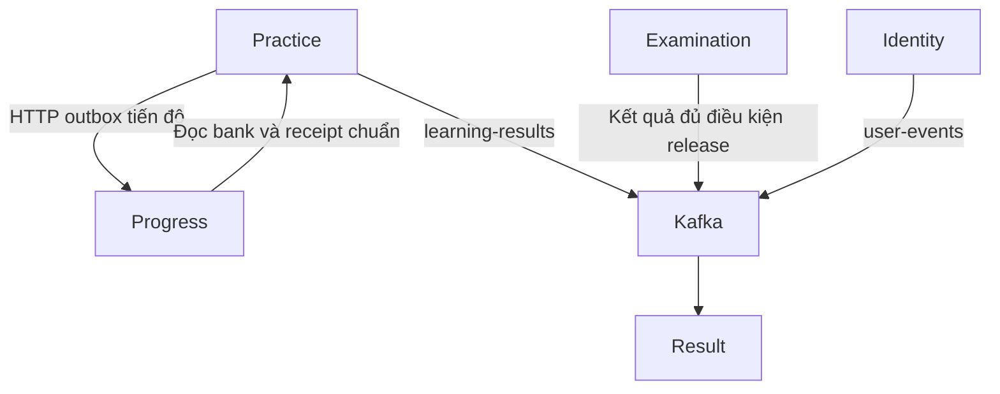

# DTS — Bàn giao triển khai VPS cho bộ chức năng đã hoàn thiện trên local

**Vị trí lưu trong repo:** `dts-system-fontend/docs/DEPLOYMENT_VPS_HANDOFF.md`  
**Ngày lập:** 18/10/2026, múi giờ Việt Nam.  
**Người đọc:** thành viên phụ trách tích hợp nhánh, GitHub Actions, Docker, VPS, database và nghiệm thu bản phát hành.

> Mục tiêu: giữ cách tổ chức hệ thống DTS hiện có, triển khai đúng bộ code và dữ liệu cần thiết để các chức năng đã chạy trên local tiếp tục hoạt động trên VPS. Tài liệu này là hướng dẫn bàn giao dựa trên source và các kết quả local đã cung cấp; chưa phải biên bản xác nhận môi trường VPS đã được nâng cấp.

## Mục lục

1. [Kết luận và phạm vi bàn giao](#1-kết-luận-và-phạm-vi-bàn-giao)
2. [Bộ source và mốc phiên bản](#2-bộ-source-và-mốc-phiên-bản)
3. [Kiến trúc cần duy trì](#3-kiến-trúc-cần-duy-trì)
4. [Quy trình triển khai đang có trên main](#4-quy-trình-triển-khai-đang-có-trên-main)
5. [Các điểm phải hoàn thiện trước khi merge và deploy](#5-các-điểm-phải-hoàn-thiện-trước-khi-merge-và-deploy)
6. [Thay đổi và trách nhiệm của từng repo](#6-thay-đổi-và-trách-nhiệm-của-từng-repo)
7. [Database và migration](#7-database-và-migration)
8. [Cấu hình môi trường cần bàn giao](#8-cấu-hình-môi-trường-cần-bàn-giao)
9. [Địa chỉ service, mạng và cổng](#9-địa-chỉ-service-mạng-và-cổng)
10. [Đăng nhập, JWT và kết nối nội bộ](#10-đăng-nhập-jwt-và-kết-nối-nội-bộ)
11. [Kafka, outbox và đồng bộ dữ liệu](#11-kafka-outbox-và-đồng-bộ-dữ-liệu)
12. [Ngân hàng câu hỏi, bộ đề và media](#12-ngân-hàng-câu-hỏi-bộ-đề-và-media)
13. [Thứ tự triển khai đề xuất](#13-thứ-tự-triển-khai-đề-xuất)
14. [Nghiệm thu nghiệp vụ sau triển khai](#14-nghiệm-thu-nghiệp-vụ-sau-triển-khai)
15. [Định hướng xử lý các triệu chứng thường gặp](#15-định-hướng-xử-lý-các-triệu-chứng-thường-gặp)
16. [Khôi phục phiên bản khi triển khai không đạt](#16-khôi-phục-phiên-bản-khi-triển-khai-không-đạt)
17. [Phân công và hồ sơ phát hành](#17-phân-công-và-hồ-sơ-phát-hành)
18. [Thông tin thực tế người triển khai phải điền](#18-thông-tin-thực-tế-người-triển-khai-phải-điền)
19. [Điều kiện chốt bàn giao](#19-điều-kiện-chốt-bàn-giao)
20. [Nguồn đối chiếu và giới hạn xác minh](#20-nguồn-đối-chiếu-và-giới-hạn-xác-minh)

## 1. Kết luận và phạm vi bàn giao

### 1.1. Điều cần hiểu trước khi triển khai

- Có thể giữ kiến trúc microservice hiện tại của DTS. Việc triển khai các chức năng mới không tự đặt ra yêu cầu đổi công nghệ điều phối hay gom các repo thành một ứng dụng.
- Bộ code đã mở rộng API, schema, cơ chế outbox, dữ liệu lịch sử, EXP và projection tiến độ. VPS phải có những điều kiện tương ứng thì chức năng mới hoạt động đầy đủ.
- Git chứa source, migration, tài liệu và một số dữ liệu phát hành/importer. Database, object MinIO, Kafka offsets, tài khoản và secret đang dùng ở local không được chuyển sang VPS chỉ bằng thao tác merge.
- Kiểm tra Git đã thực hiện xác nhận nội dung source, cách chia commit và quan hệ với main tại thời điểm kiểm tra. Nó không thay cho kiểm tra môi trường production.

**Điểm cần điều phối ngay:** các workflow đã đọc trên main của cả chín repo đều có trigger `push` vào `main` và có bước triển khai VPS. Merge PR cập nhật main có thể làm container production được cập nhật nếu workflow được bật và các bước trước deploy thành công. Người triển khai cần chốt kế hoạch migration, cấu hình và thứ tự service trước khi merge những repo liên quan.

### 1.2. Nguyên tắc của đợt bàn giao này

1. Giữ nguyên nghiệp vụ và giao diện đã được duyệt; các việc về deploy tập trung vào đóng gói, cấu hình, migration và khả năng kết nối.
2. Thay đổi cấu trúc database phải có file migration được quản lý trong repo và được thực thi có chủ đích ở đúng database.
3. SQL đã áp dụng phải giữ nguyên nội dung, version và checksum. Thay đổi tiếp theo cần version migration mới theo cơ chế của repo.
4. Không dùng Hibernate `update` để bù cho migration còn thiếu. Chọn `none` hoặc `validate` theo hướng dẫn cụ thể của từng service.
5. Giữ dữ liệu nghiệp vụ, migration history, volume PostgreSQL/MinIO và khả năng khôi phục môi trường đang phục vụ người dùng.
6. Source, image, bộ migration và cấu hình thực tế phải được ghi nhận theo cùng một bản phát hành.

### 1.3. Những việc tài liệu này chưa xác nhận

Chưa truy cập VPS để xác nhận topology, container đang chạy, phiên bản database, giá trị environment hiệu lực, GitHub Secrets, DNS, TLS, firewall, dung lượng hay tài nguyên. Địa chỉ và cổng thấy trong main chỉ là cấu hình được check-in. Mọi mục còn thiếu tại phần 18 phải được người quản lý môi trường hoàn thiện trước khi sử dụng các ví dụ triển khai.

## 2. Bộ source và mốc phiên bản

### 2.1. Các nhánh chức năng được bàn giao

Các mốc dưới đây lấy từ output Git đã được cung cấp trong quá trình chuẩn bị repo. Chúng dùng để xác định bộ thay đổi cần tích hợp, không mô tả image hiện đang chạy trên VPS.

| Repo | Nhánh chức năng | Commit chức năng/tài liệu cuối đã ghi nhận | Trạng thái tại thời điểm bàn giao |
| --- | --- | --- | --- |
| dts-content-builder | `feature/2026-license-question-bank-media` | `04c689f11ce1bcb91d9c0038bb1209036bc2899a` | Đã có output xác minh push; đã có xác nhận web local hoạt động |
| dts-practice | `feature/2026-license-practice-exams` | `6373cc8627649ff6bfe0cd2fc5d736f26aaea802` | Đã có output xác minh push |
| dts-media | `feature/traffic-sign-media` | `496505d8882ef6b1e5426ca91650b00e3e48ddbe` | Đã có output xác minh push |
| dts-identity | `feature/content-builder-chapter-permissions` | `e49bba0a66b693d5ee1698457fed27f03019f04a` | Đã có output xác minh push |
| dts-gateway | `chore/backend-service-integration` | `0e96e9fba28f305c15f642243cc9607200aa6a32` | Đã có output xác minh push |
| dts-progress | `feature/progress-backend-completion` | `f775eaa8a9a4be14d550b1ff1e7831326888f355` | Đã có output xác minh push |
| dts-examination | `feat/official-exam-workflow` | `a701c3571e6499516b08a587d3febb2c5039f7b2` | Đã có output xác minh push |
| dts-result | `fix/result-persistence-and-kafka-retry` | `c828628` — SHA rút gọn | Bảy commit local đã kiểm tra; push bị GitHub từ chối với tài khoản `nnga24`, đang chờ xử lý quyền |
| dts-system-fontend | `feat/user-ui-redesign` | `089759a` — SHA rút gọn | Mười tám commit local đã ghi nhận; push trước đó bị từ chối quyền; có thêm chỉnh sửa màn hình thi chính thức sau lần kiểm tra 17 commit |

Trước build, người tích hợp phải lấy SHA đầy đủ của các mốc rút gọn và xác nhận các nhánh đã hiện diện trên remote. Việc bổ sung chính tài liệu này sẽ tạo thêm một thay đổi/commit docs sau mốc frontend trong bảng. Lệnh kiểm tra frontend cũ cố định 17 commit và checksum cũ không còn phù hợp nguyên trạng.

Commit `089759a` chỉ được đối chiếu qua diff/output người dùng cung cấp: bỏ nhãn chương, nhãn/dấu câu điểm liệt và chú thích liên quan trong màn hình đang làm bài thi chính thức, cùng chỉnh bố cục. Không hiểu việc ẩn gợi ý trên giao diện là thay đổi quy tắc chấm hoặc bỏ xử lý câu điểm liệt ở backend.

### 2.2. Main đã đọc để lập tài liệu

| Repo | SHA main được đọc ngày 18/10/2026 |
| --- | --- |
| dts-content-builder | `e727ff795ed149da4eb9e77c2d6a22be8f8e03a6` |
| dts-practice | `237b9f5a27939e5dba946a656cae50e6d08f7d75` |
| dts-media | `f96e3244779966a046bc18e75e6cb39e9fe9d7ee` |
| dts-identity | `cddd096909245c7909a7183d2bebfcaeb9fa56dd` |
| dts-gateway | `3a34f373073b111641c4475fc53c32dbd2574cfb` |
| dts-progress | `983f5378382a1430c78af7a4f2cb5365cb51eee2` |
| dts-examination | `416924c78c943b926d2743c8cd30acdfabf2c752` |
| dts-result | `ccedb4f7fa772126a42449441b3c721f3e3ae98d` |
| dts-system-fontend | `5c7f4a3e231b408c08c36a15b6a09036f4e31a99` |

Main có thể thay đổi sau thời điểm này. Trước merge cần cập nhật lại so sánh, xem cách giải quyết conflict của các file đã sửa và giữ bộ code đã được nghiệm thu. Nếu dùng squash merge, SHA main dùng để build sẽ khác SHA nhánh chức năng; ghi cả hai trong hồ sơ phát hành.

## 3. Kiến trúc cần duy trì

### 3.1. Vai trò các thành phần

| Thành phần | Trách nhiệm |
| --- | --- |
| Frontend Next.js | Hiển thị trang, quản lý trạng thái giao diện và gọi API qua proxy tới Gateway |
| Gateway | Định tuyến các nhóm API, chuyển tiếp xác thực theo thiết kế hiện có và bảo vệ các route nội bộ liên quan |
| Identity | Tài khoản, đăng nhập, JWT, role/permission, hồ sơ và hạng GPLX đã chọn |
| Content Builder | Quản trị nội dung, ngân hàng câu hỏi và API nguồn nội bộ theo GPLX; biển báo và mẹo |
| Practice | Nguồn dữ liệu học/ôn/thi thử, phiên làm bài, đáp án, receipt và outbox tương ứng |
| Examination | Cấu hình, phiên bản, đề/đáp án đã đóng băng, phiên thi chính thức và công bố kết quả |
| Progress | Tổng hợp tiến độ từ dữ liệu nguồn chuẩn; learning overview và các phần tiến độ hiện có |
| Result | Read model lịch sử, kết quả đã phát hành, EXP, hồ sơ công khai và analytics |
| Media | Metadata, phiên upload, policy và URL truy cập media; binary do storage/MinIO lưu |
| PostgreSQL, Kafka, Redis, MinIO | Hạ tầng dữ liệu, truyền sự kiện, cache và object storage theo cấu hình môi trường |

Mỗi backend tiếp tục sở hữu dữ liệu của mình. Không đưa thao tác SQL của backend vào frontend để khắc phục thiếu migration hoặc thiếu dữ liệu.

### 3.2. Các luồng đồng bộ quan trọng của bộ code mới



Sơ đồ giới hạn ở các luồng đồng bộ liên quan trực tiếp tới thay đổi đã bàn giao; không biểu diễn toàn bộ endpoint hoặc mọi consumer của hệ thống. Gateway phục vụ API public; các kết nối nội bộ có cơ chế và địa chỉ riêng cần được cấu hình đúng.

Outbox cho phép service lưu dữ liệu nguồn và chuyển tiếp sau khi đích sẵn sàng. Điều đó có thể tạo khoảng trễ hợp lệ giữa lúc hoàn tất bài và lúc lịch sử/tiến độ cập nhật. Khả năng retry không thay cho việc cấu hình URL, key, broker và consumer đúng.

## 4. Quy trình triển khai đang có trên main

### 4.1. Luồng được quan sát từ workflow

1. Push cập nhật `main` kích hoạt `.github/workflows/deploy.yml`.
2. Runner checkout source và thực hiện các bước build/kiểm tra được từng repo khai báo.
3. Tạo Docker image, gắn tag `latest` và tag SHA của commit rồi đẩy lên GHCR.
4. Copy `docker-compose.prod.yml` đến thư mục triển khai trên VPS.
5. Qua SSH, đổi compose production thành compose đang dùng; một số repo còn tạo lại `.env`.
6. Pull image và chạy `docker compose up -d`; nhiều workflow có bước prune image/cache.

Đây là cấu hình source đã đọc, chưa xác nhận Actions đang được bật hoặc Secrets/SSH của từng repo hiện hoạt động. Một số workflow bỏ qua một phần test; thành công của job không tự chứng minh tất cả nghiệp vụ đã được kiểm tra.

### 4.2. Image và thư mục deploy theo source main

Registry là GHCR dưới owner của dự án; bảng chỉ ghi tên cuối của image.

| Repo | Image ứng dụng | Thư mục deploy workflow đang ghi | Điểm cần chú ý |
| --- | --- | --- | --- |
| Content Builder | `content-builder` | `/dts/content-builder` | Runtime build không tự nhập bộ nội dung phát hành |
| Practice | `practice-service` | `/dts/practice-service` | Workflow tạo lại `.env` với một tập biến hữu hạn |
| Media | `media-service` | `/dts/media` | Workflow còn build MinIO và vận hành compose có Kafka/Zookeeper/MinIO |
| Identity | `identity-service` | `/dts/identity-service` | Compose gồm cả Redis; cần giữ dữ liệu và cấu hình đang dùng |
| Gateway | `gateway-service` | `/dts/gateway` | Workflow còn build image Eureka; compose hiện được đọc chỉ khai báo Gateway |
| Progress | `progress-service` | `/dts/progress-service` | Workflow tạo lại `.env` với một tập biến hữu hạn |
| Examination | `examination` | `/dts/examination` | Bộ canonical migration cần bước riêng |
| Result | `dts-result` | `/dts/dts-result` | Bộ canonical migration cần bước riêng; workflow tạo lại `.env` |
| Frontend | `dts-frontend` | `/dts/dts-frontend` | Gateway URL được truyền ở bước build |

Thư mục deploy được workflow dùng có thể chỉ chứa compose và environment. Không mặc định trong đó có Git checkout, `docs/db`, `tools` hay dữ liệu import.

### 4.3. Điều phối trước merge

Người quản lý release chọn cơ chế phù hợp với quyền và quy trình của nhóm: tách build khỏi deploy, thêm bước triển khai được điều phối, hoặc lập lịch nâng cấp có kiểm soát cho pipeline hiện có. Tài liệu này không thay đổi workflow và không tự bật/tắt Actions.

Điều kiện cần đạt là: không để code yêu cầu schema mới chạy trước migration tương ứng; không để frontend mới phục vụ người dùng trước các API mà nó cần. Nếu schema mới chưa chứng minh tương thích với app cũ, phải có khoảng dừng các tiến trình ghi dữ liệu bị ảnh hưởng trong cửa sổ nâng cấp.

## 5. Các điểm phải hoàn thiện trước khi merge và deploy

Đây là các điểm đối chiếu giữa source mới và cấu hình main đã đọc. Cột “việc cần làm” là công việc bàn giao, chưa được thực hiện trên VPS trong đợt chuẩn bị Git.

| Mã | Quan sát từ source | Ảnh hưởng | Việc người triển khai cần làm |
| --- | --- | --- | --- |
| DEP-01 | Chín workflow gắn deploy với push main | Merge có thể cập nhật production ngay | Chốt cửa sổ và cơ chế điều phối trước merge |
| DEP-02 | Result/Examination có runner riêng; workflow chưa gọi runner; runtime image chỉ mang JAR | Image mới chưa bảo đảm DB có schema mới | Cấp checkout/gói migration đúng phiên bản và bước apply/verify riêng |
| DEP-03 | Một số YAML nền còn `ddl-auto: update`; profile/environment có thể override | Có thể sửa DDL ngoài quy trình migration đã yêu cầu | Chốt cấu hình hiệu lực `none`/`validate` theo từng repo |
| DEP-04 | Compose Practice chưa truyền bộ biến progress outbox mới; Compose Progress chưa truyền đủ kết nối đọc Practice/internal key | Bài làm lưu được nhưng projection tiến độ chưa đồng bộ | Bổ sung đúng biến vào container và nguồn cấu hình release |
| DEP-05 | Examination dùng Feign với `CONTENT_BUILDER_URL`, `IDENTITY_SERVICE_URL`; compose main chưa truyền các URL này | Phụ thuộc default/service discovery có thể không phù hợp topology | Chọn URL trực tiếp hoặc chứng minh discovery hiện hữu hoạt động; cấu hình nhất quán |
| DEP-06 | Frontend build dùng `GATEWAY_API_URL`; main có URL/IP được gắn vào build | Thay environment runtime có thể vẫn giữ proxy đích cũ | Chốt Gateway URL truy cập được từ container frontend và build lại image |
| DEP-07 | URL Docker, cổng container và cổng host khác bố trí Windows | API trực tiếp có thể chạy nhưng Gateway/proxy lỗi | Lập bảng kết nối thực tế và đối chiếu từ nơi phát request |
| DEP-08 | Practice, Progress, Result tạo lại `.env` trong workflow | Biến thêm tay trên VPS có thể mất ở lần deploy kế tiếp | Bổ sung vào cơ chế cấp secret/environment và compose/workflow tương ứng |
| DEP-09 | Image không tự mang database, bucket, checkpoint nhập nội dung | Môi trường mới có thể thiếu bank/preset/ảnh hoặc read model | Chuẩn bị dữ liệu theo phần 12, giữ mapping riêng của môi trường |
| DEP-10 | Image `latest` được dùng và nhiều job prune image | Khó xác định/khôi phục chính xác bản cũ nếu chỉ dựa cache VPS | Ghi SHA/digest ứng dụng trước và sau; giữ tag có thể pull từ registry |
| DEP-11 | Workflow Media build MinIO từ `github.com/minio/minio@latest` và compose còn vận hành hạ tầng | Merge policy Media có thể đi kèm thay phiên bản hạ tầng storage | Review phạm vi deploy Media, chốt phiên bản MinIO và bảo toàn volume theo kế hoạch release |

Các khác biệt environment không tự chứng minh ứng dụng đang lỗi trên VPS. Cấu hình thật có thể đã được override ngoài repo; cần đọc effective configuration trước khi quyết định sửa.

## 6. Thay đổi và trách nhiệm của từng repo

### 6.1. dts-identity

- Lưu và trả thông tin hồ sơ người học, hạng GPLX đã chọn; auth response và user response liên quan được cập nhật.
- `selected_license_class` cho phép null với tài khoản chưa chọn, không tự gán tất cả tài khoản cũ sang A1.
- V9 bổ sung trường/constraint; V10 bổ sung permission `exams:update` và mapping quản trị tương ứng.
- Identity tiếp tục là nguồn chuẩn cho user, trạng thái, GPLX và quyền. Không lấy userId tùy ý từ query/header của client để thay người đang đăng nhập.
- Sau thay đổi quyền cần token được cấp/refresh phù hợp; token cũ có thể chưa mang permission mới.
- VPS cần database/Redis, JWT, issuer, mail và Kafka theo cấu hình thực tế. SMTP cần cho các luồng xác minh hoặc khôi phục tài khoản đang sử dụng.

### 6.2. dts-content-builder

- API nguồn nội bộ đọc bank/câu hỏi theo GPLX phục vụ Examination; cung cấp metadata/batch detail và snapshot nguồn phù hợp.
- Bổ sung quản trị nội dung biển báo và mẹo ghi nhớ, cùng bảng và migration tương ứng.
- Ngân hàng câu hỏi/nội dung phải đạt trạng thái publish và có liên kết ảnh/mapping đúng; sự tồn tại của JSON trong repo không tự tạo các row đó trong DB.
- Bản YAML đã bàn giao giữ Flyway tắt và còn Hibernate `update`; hướng dẫn setup yêu cầu chủ động quản lý schema bằng SQL và override DDL khi vận hành theo nguyên tắc migration.
- Với DB mới, V3 dùng trigger function trước V4; file tiền đề `docs/sql/00__bootstrap_trigger_set_updated_at.sql` hỗ trợ đúng thứ tự bootstrap. Không chạy bộ bootstrap mới lên DB đã có bảng.
- Dữ liệu và tool nằm trong `data/`/`tools`; chạy importer từ checkout đầy đủ khi cần, không mặc định JAR tự thực hiện.

### 6.3. dts-practice

- Học theo chương, cursor, bookmark, ôn chương; học/ôn câu điểm liệt và các câu đã làm sai.
- Thi thử ngẫu nhiên, bộ đề có sẵn, chế độ luyện tập, tiếp tục/tạm dừng, hoàn tất, kết quả và làm lại theo API hiện có.
- Lưu receipt/outbox tiến độ và chuyển tiếp sang Progress; lưu outbox lịch sử kết quả và bằng chứng câu trả lời đúng phục vụ EXP.
- V28 mở rộng lịch sử/outbox; V27.1 và V29 bảo toàn/khôi phục audit trong quá trình nâng cấp; V30 bổ sung EXP outbox/policy.
- VPS cần đúng bank, version bank, mapping chương, preset và nội dung tham chiếu. Không tái tạo question ID hoặc chạy lại công cụ chuẩn bị source chỉ để làm khớp một database khác.
- Practice là nguồn chuẩn của đáp án và phiên thi thử. Không sửa Result để thay thế kết quả nguồn chưa phát được.

### 6.4. dts-progress

- Nhận và xác minh sự kiện tiến độ chuẩn từ Practice; chống áp dụng lặp theo thiết kế inbox/receipt.
- Lưu projection câu hỏi theo user, GPLX, bank version và question; cung cấp learning overview theo phạm vi đó.
- V2 bổ sung unique index theo user/exam, V3 thêm projection/inbox câu hỏi.
- Có kết nối đọc Practice để lấy bank/receipt; chỉ bật API Progress nhưng thiếu đường đọc ngược về Practice chưa đủ cho luồng mới.
- Các bảng tiến độ legacy tiếp tục tồn tại; V3 không tự suy diễn toàn bộ dữ liệu lịch sử cũ thành projection mới.

### 6.5. dts-examination

- Phân quyền quản trị và hợp đồng lỗi/API; cấu hình rule/criteria/structure, examination và version; bảo vệ lịch sử tham chiếu khi cập nhật.
- Chọn câu theo GPLX/ma trận, publish version và đóng băng dữ liệu cần chấm.
- Danh mục học viên dựa vào hồ sơ Identity, GPLX, thời gian và điều kiện lượt thi.
- Lưu phiên, đề, đáp án, tiến độ, thời gian, chấm bài, submit lặp và các outbox liên quan.
- Kết quả chính thức chỉ được phát/hiển thị theo release policy; bài chưa release không được lộ điểm/đáp án qua việc “khắc phục deploy”.
- Canonical V001–V004 ở `docs/db`; runner và manifest thuộc source vận hành, không được bỏ khi đóng gói migration.
- Worker khi ứng dụng boot có thể xử lý hết hạn, backfill và gửi outbox. Khởi động service là thao tác có thể ghi dữ liệu nghiệp vụ.

### 6.6. dts-result

- Nhận kết quả nguồn đã đủ điều kiện, lưu typed history và cung cấp lịch sử/detail thuộc người dùng.
- Ghi bằng chứng câu hỏi, policy EXP và projection hồ sơ công khai từ Identity với consumer riêng.
- Cung cấp leaderboard EXP và analytics chuẩn hóa; điểm gốc, điểm chuẩn hóa và EXP có ý nghĩa khác nhau.
- Canonical V001–V004 cấp schema cho result/summary và projection mới; migration phải đi qua runner có kiểm manifest/history.
- Thiếu profile có thể trả trạng thái chờ; thiếu policy nguồn có thể có `SOURCE_POLICY_PENDING`. Không tự điền tên/điểm/scale giả để làm UI đầy đủ.
- Schema canonical không bao phủ toàn bộ tám bảng entity legacy khác trong repo. Các API legacy dùng những bảng đó cần trạng thái schema riêng của môi trường; không bật Hibernate `update` để tự sinh toàn bộ.

### 6.7. dts-media

- Thay đổi chức năng mới của đợt commit là migration V5 cho policy `TRAFFIC_SIGN`, phục vụ upload WebP public của biển báo.
- Tiếp tục luồng khởi tạo upload, PUT theo presigned URL, xác nhận, xử lý trạng thái và đọc URL/metadata.
- PostgreSQL giữ metadata; MinIO giữ binary. Policy được tạo thành công không có nghĩa ảnh đã được upload và READY.
- Public endpoint phải truy cập được từ browser/importer; endpoint nội bộ phải truy cập được từ worker. Không đổi host/query của URL đã ký để chữa lỗi mạng.
- Trước deploy Media phải review cả tác động lên Kafka/Zookeeper/MinIO trong compose/workflow đang có.

### 6.8. dts-gateway

- Giữ các nhóm route Identity, Practice, Progress, Content Builder, Examination, Result và Media.
- Bổ sung guard giới hạn proxy Result theo route versioned, bảo vệ các đường nội bộ tương ứng.
- Cần đúng origin và rewrite của từng service; origin là địa chỉ service, không tự thêm prefix public vào cuối.
- Cấu hình local từng gặp trường hợp Progress/Examination direct HTTP 200 nhưng qua Gateway/proxy HTTP 500 vì URL không phù hợp môi trường. Deploy phải kiểm đường qua Gateway, không chỉ kiểm backend direct.
- Không tự bật/tắt Eureka hoặc đổi cơ chế discovery khi chưa thống nhất với hệ thống VPS. Các URL trực tiếp và cấu hình discovery hiện có cần được đối chiếu thành một phương án nhất quán.

### 6.9. dts-system-fontend

- Tích hợp auth, refresh, GPLX, app shell; các nhóm trang thi thử, chương, điểm liệt, câu sai, biển báo/mẹo, dashboard luyện tập.
- Tích hợp danh mục/phiên/kết quả thi chính thức, lịch sử, bảng xếp hạng, analytics, tiến độ và hồ sơ/bảo mật.
- Tích hợp quản trị câu hỏi/chương/chương trình và ma trận/cấu hình/version bài thi chính thức.
- Browser gọi các API cùng origin; Next proxy sang Gateway. `GATEWAY_API_URL` cần đúng tại bước build hiện tại.
- Tên bài và điều hướng kết quả phải giữ logic snapshot/source đã có; không sửa dữ liệu lịch sử để bù lỗi hiển thị.
- Thay đổi mới nhất ẩn chương và dấu điểm liệt khi đang thi chính thức; backend vẫn giữ policy và chấm theo đề đã freeze.
- Một số phần giao diện quản trị, như settings hiện có, chưa tương ứng đầy đủ API lưu cấu hình. Không mở rộng cam kết nghiệp vụ chỉ từ việc trang hiển thị được.

## 7. Database và migration

### 7.1. Ma trận cơ chế schema

| Repo | Nguồn SQL | Cơ chế thực thi hiện có | Mốc liên quan bộ bàn giao |
| --- | --- | --- | --- |
| Identity | `src/main/resources/db/migration` | Flyway | Đủ dòng V1–V10; thay đổi mới gồm V9/V10 |
| Practice | `src/main/resources/db/migration` | Flyway | Dòng V1–V30 và V27.1; không bỏ các version trung gian |
| Progress | `src/main/resources/db/migration` | Flyway | V1–V3; V2/V3 cho luồng mới |
| Media | `src/main/resources/db/migration` | Flyway | V1–V5; V5 cho TRAFFIC_SIGN |
| Content Builder | SQL trong `src/main/resources/db/migration`, tiền đề trong `docs/sql` | Flyway đang tắt trong source; bootstrap/upgrade SQL có chủ đích | Bootstrap mới theo tài liệu với tiền đề và V2–V5; DB hiện hữu phải có kế hoạch theo schema thật |
| Examination | `docs/db/migrations`, `schema-manifest.json`, `apply-schema.psql`, `verify-schema.sql`, runner `tools` | Canonical runner; history `dts_examination_schema_history` | V001–V004 |
| Result | `docs/db/migrations`, manifest/apply/verify và runner `tools` | Canonical runner; history `dts_result_schema_history` | V001–V004 |
| Gateway, Frontend | Không có schema nghiệp vụ cần tạo trong phạm vi này | Không chạy SQL của các backend thay chúng | Cấu hình/đóng gói và API tương thích |

Mốc trên mô tả source cần có, không yêu cầu chạy lại tất cả SQL trên DB đã có. Trước nâng cấp phải đọc version/history/schema thực tế của từng database VPS và xác định migration còn thiếu.

### 7.2. Chuẩn bị trước khi áp dụng

Người phụ trách database ghi nhận tên DB, server/port, role, version PostgreSQL, schema/history hiện tại và SHA bộ SQL. Sao lưu đúng DB và chứng minh khôi phục vào môi trường tách biệt; giữ bản sao trước nâng cấp. Đối chiếu dữ liệu và schema trên clone sau migration, bao gồm các row/audit đang được bảo toàn.

Các bằng chứng backup/clone đã có trên máy local không tự là bằng chứng của DB VPS. DB có bảng cũ nhưng chưa có history cần được xem xét theo từng cơ chế; không tự đánh dấu baseline/success hoặc đổi checksum để vượt lỗi.

Nếu các writer/worker vẫn chạy trong lúc chụp và so sánh dữ liệu, phải dùng phương án nhất quán phù hợp hoặc điều phối chúng trong cửa sổ nâng cấp. Không kết luận mất dữ liệu chỉ từ hai ảnh chụp được lấy khi hệ thống còn ghi đồng thời.

### 7.3. Flyway: Identity, Practice, Progress, Media

- Chạy phiên bản SQL còn thiếu theo thứ tự version và đúng history của DB đích.
- Source có thể bật Flyway khi Spring Boot khởi động. Bật nó ở một lần nâng cấp có kế hoạch là thao tác ghi DB; không coi việc boot là kiểm tra chỉ đọc.
- Nếu nhóm chọn job migration riêng, phải dùng cấu hình và Flyway tương thích dependency của release; chưa có nghĩa mọi repo đã có một CLI/job migration độc lập được cấu hình sẵn.
- Sau nâng cấp, giữ chế độ xác minh và thực thi migration theo chính sách đã chốt; Hibernate không tự sửa DDL.
- Practice Docker profile hiện dùng Hibernate `none`, tránh tự ý đổi sang `validate` do khác biệt mapping array PostgreSQL đã được ghi nhận trong source. Identity/Progress có thể dùng `validate` theo tài liệu; Media dùng `none`.
- Với Practice, thứ tự số là `27 → 27.1 → 28 → 29 → 30`. Giữ cả `V27_1__preserve_exam_audit_during_history_upgrade.sql` và `V29__restore_exam_audit_after_history_upgrade.sql`.
- Nếu VPS đã ở version cao hơn nhưng thiếu migration trung gian như 27.1, dừng để đánh giá dòng nâng cấp thật; không tự bật out-of-order hay repair để làm lịch sử trông hợp lệ.
- Progress V2 tạo unique index theo cặp user/exam; dữ liệu cũ trùng cặp cần kế hoạch riêng trước nâng cấp, không tự xóa row.

### 7.4. Content Builder: phân biệt DB mới và DB đã sử dụng

DB mới cần thực hiện đúng bootstrap trong `docs/LOCAL_SETUP.md`, gồm hàm tiền đề và V2→V5. Bootstrap thủ công này không tạo Flyway history. Không bật Flyway trên DB đã bootstrap như vậy nếu chưa có kế hoạch quản lý lịch sử tương ứng.

Với DB đang phục vụ nội dung, trước tiên kiểm tra các bảng, trigger, constraint và dữ liệu hiện có. V5 không phải lệnh tùy ý chạy lặp; không chạy toàn bộ bootstrap để “lấy đủ chức năng”. Sau khi schema đã được cấp, ứng dụng phải dùng cấu hình DDL theo nguyên tắc migration của release.

### 7.5. Examination và Result: bộ canonical runner

Phải có checkout/gói vận hành đúng phiên bản, bao gồm `docs/db`, manifest, runner Python và các file do manifest quản lý. Chỉ copy vài file `V00x.sql` hoặc chỉ có Docker image JAR chưa đủ để dùng runner nguyên trạng.

Runner xác minh file/hash; apply có guard database, transaction, advisory lock, history/checksum và kiểm tra schema. Lần chạy sau bỏ qua version đã thực thi theo cơ chế của runner. Examination còn kiểm mapping JPA khi source Java hiện diện. Giữ nguyên các file manifest quản lý và cấu trúc include tương đối.

Ví dụ dưới đây dành cho người vận hành Linux đã chuẩn bị môi trường và checkout. Đây là **lệnh ghi schema**, không phải lệnh tự chạy khi đọc tài liệu. Các biến `PG*` phải trỏ đúng PostgreSQL VPS; không dùng mặc định cổng Windows local.

```bash
# Chuẩn bị từ cơ chế quản lý cấu hình/credential của môi trường:
# DTS_EXAMINATION_RELEASE_DIR, PGHOST, PGPORT, PGUSER, PGPASSFILE.
# PGPASSFILE nằm ngoài Git; không ghi mật khẩu vào tài liệu hoặc command line.
(
  set -eu
  : "${DTS_EXAMINATION_RELEASE_DIR:?Set full checkout directory for this release}"
  : "${PGHOST:?Set the confirmed PostgreSQL host}"
  : "${PGPORT:?Set the confirmed PostgreSQL port}"
  : "${PGUSER:?Set the confirmed PostgreSQL role}"
  cd "$DTS_EXAMINATION_RELEASE_DIR"
  psql -X --dbname examination -v ON_ERROR_STOP=1 \
    -c 'SELECT current_database(), inet_server_addr(), inet_server_port();'
  python3 tools/screen12_schema.py --database examination --mode apply
  python3 tools/screen12_schema.py --database examination --mode verify
)
```

```bash
# Chọn đúng kết nối PG* của Result; không mặc định dùng lại host/port của repo khác.
(
  set -eu
  : "${DTS_RESULT_RELEASE_DIR:?Set full checkout directory for this release}"
  : "${PGHOST:?Set the confirmed PostgreSQL host}"
  : "${PGPORT:?Set the confirmed PostgreSQL port}"
  : "${PGUSER:?Set the confirmed PostgreSQL role}"
  cd "$DTS_RESULT_RELEASE_DIR"
  psql -X --dbname dts_result_db -v ON_ERROR_STOP=1 \
    -c 'SELECT current_database(), inet_server_addr(), inet_server_port();'
  python3 tools/screen12_schema.py --database dts_result_db --mode apply
  python3 tools/screen12_schema.py --database dts_result_db --mode verify
)
```

`SPRING_DATASOURCE_*` cấu hình Java; `PG*` cấu hình psql. Hai bộ không tự thay thế nhau. Ví dụ dùng đúng tên database trong bộ canonical đã bàn giao; nếu môi trường thật dùng tên khác, cần xem xét guard/cấu hình theo quy trình repo trước khi chạy, không đổi tên DB trong lệnh theo phỏng đoán.

Examination sau apply dùng Hibernate `validate` theo hướng dẫn repo. Result giữ `none`; canonical schema không cấp toàn bộ bảng legacy còn có entity trong source. Hai service không dùng Flyway cho dòng V001–V004, nên không dùng Flyway repair/baseline ở đây.

### 7.6. Data maintenance và dữ liệu lịch sử

`record-projection-adjustment.psql` và `data-migrations/20261016__bootstrap_missing_public_profiles.psql` của Result là công cụ bảo trì dữ liệu có điều kiện, không tự chạy trong schema apply hoặc khi boot. Chỉ dùng khi đã có bằng chứng đúng source/user/phạm vi môi trường và kế hoạch riêng.

Không lấy ID fixture hoặc danh sách loại trừ của lần nghiệm thu local áp vào production. Không seed các file `docs/db/tests` vào DB nghiệp vụ; chúng phục vụ kiểm tra runner trong môi trường tách biệt.

Ba phiên Practice TIMEOUT có thứ tự thời gian lịch sử không hợp lệ đã được người dùng chấp nhận giữ nguyên trong bối cảnh local. Đợt triển khai không tự sửa chúng, không biến chúng thành lý do chỉnh SQL migration cũ, và không suy ra rằng VPS chắc chắn có cùng ba row đó.

## 8. Cấu hình môi trường cần bàn giao

### 8.1. Nguồn cấu hình và độ bền qua lần deploy

Mỗi giá trị hiệu lực cần có nơi quản lý rõ ràng: GitHub Secret/environment, file riêng trên VPS, secret store của nhóm hoặc override Compose được pipeline thực sự đọc. `.env.example` chỉ là mẫu và không chứa credential thực.

Compose có thể đọc `.env` để nội suy, nhưng một biến có trong `.env` chưa tự trở thành environment của container: compose phải khai báo `environment`/`env_file` hoặc có cơ chế truyền tương ứng. Chạy Java trực tiếp bằng Maven/Gradle cũng không mặc định đọc `.env` như một file cấu hình Spring.

Các workflow Practice, Progress và Result đang ghi lại `.env` từ một tập biến cụ thể. Khi bổ sung biến, cập nhật cả nguồn cung cấp và nơi truyền vào container; sửa tay `.env` trên VPS có thể bị ghi đè ở đợt deploy sau.

### 8.2. Ma trận biến kết nối và hành vi cần đối chiếu

| Service | Biến/property chính | Yêu cầu |
| --- | --- | --- |
| Tất cả backend có DB | `SPRING_DATASOURCE_*` hoặc bộ `DB_HOST/DB_PORT/DB_NAME/DB_USERNAME/DB_PASSWORD` mà YAML/profile repo sử dụng | Đúng DB/role thật; xác minh property đang được đọc, không mặc định mọi repo dùng cùng tên biến |
| Backend có Hibernate | `SPRING_JPA_HIBERNATE_DDL_AUTO` | Chốt `none`/`validate` theo phần 7, không tự sửa DDL |
| Backend Flyway | `SPRING_FLYWAY_ENABLED`, cấu hình validate/history liên quan | Thực thi nâng cấp có chủ đích; giữ checksum/history |
| Identity | JWT access/refresh secret, issuer, Redis, Kafka, SMTP/`APP_MAIL_*` | Cấu hình của môi trường production; bảo toàn phiên/tài khoản theo nghiệp vụ |
| Content Builder | `JWT_SECRET`/property `jwt.secret`, datasource, cấu hình storage/kết nối theo source | Cùng khóa access phù hợp với Identity và Examination; kiểm tên biến YAML thật trước override |
| Practice | `IDENTITY_SERVICE_URL`, `KAFKA_BOOTSTRAP_SERVERS`, Redis, JWT/issuer | Gọi được Identity/broker/cache từ chính container |
| Practice → Progress | `PROGRESS_SERVICE_URL`, `EXAM_PROGRESS_INTERNAL_KEY`, `EXAM_PROGRESS_OUTBOX_ENABLED` | URL Progress đúng; key trùng hai phía; chỉ bật khi cấu hình/kết nối sẵn sàng |
| Progress → Practice | `PRACTICE_SERVICE_URL`, `EXAM_PROGRESS_INTERNAL_KEY`, `IDENTITY_SERVICE_URL` | Đọc được bank/receipt từ đúng Practice, xác minh ingress theo source |
| Examination | `CONTENT_BUILDER_URL`, `IDENTITY_SERVICE_URL`, `JWT_SECRET`, `KAFKA_BOOTSTRAP_SERVERS` | Feign URL là origin, không thêm `/api/...`; khóa Base64 phù hợp nguồn bank |
| Examination worker | Property `dts.examination.session-worker.enabled` | Bật theo kế hoạch; xác nhận override hiệu lực; expiry/backfill/outbox có thể ghi dữ liệu khi boot |
| Result | `SPRING_KAFKA_BOOTSTRAP_SERVERS`, `JWT_SECRET`, `JWT_ISSUER` | Cùng môi trường issuer/key, đúng broker |
| Result topics | `KAFKA_TOPIC_LEARNING_RESULTS`, `KAFKA_TOPIC_LEARNING_RESULTS_DLT`; property `result.public-profile.topic` | Tên phù hợp producer/consumer; mặc định source tương ứng `learning-results`, `learning-results-dlt`, `user-events`; xác nhận override property thật khi đổi topic |
| Media | `SPRING_DATASOURCE_*`, `SPRING_KAFKA_BOOTSTRAP_SERVERS`, `MINIO_ENDPOINT`, `MINIO_INTERNAL_ENDPOINT`, `MINIO_ACCESS_KEY`, `MINIO_SECRET_KEY` | Cấp metadata/storage thật; tách URL browser truy cập và URL worker truy cập |
| Gateway | `IDENTITY_SERVICE_URL`, `PRACTICE_SERVICE_URL`, `PROGRESS_SERVICE_URL`, `CONTENT_BUILDER_SERVICE_URL`, `EXAMINATION_SERVICE_URL`, `RESULT_SERVICE_URL`, `MEDIA_SERVICE_URL` | Đủ đường tới bảy service theo topology và đúng port container/host |
| Frontend build | `GATEWAY_API_URL` | Đích truy cập được từ Next server/container; truyền lúc build theo Dockerfile/workflow hiện có |
| Các service có Eureka | `EUREKA_*` hoặc property Eureka mà repo đọc | Giữ phương án discovery/direct URL đã chốt; không dựa vào default khác môi trường |

`CONTENT_BUILDER_URL` của Examination và `CONTENT_BUILDER_SERVICE_URL` của Gateway là hai tên khác nhau. Đặt đúng nơi sử dụng; không đổi source để gom tên trong đợt deploy này.

### 8.3. Các khoản không đưa vào tài liệu/Git

Không đưa JWT signing secret, mật khẩu DB/Redis/MinIO/SMTP, token GHCR, SSH private key, access/refresh token người dùng vào tài liệu phát hành. Bàn giao tên secret và nơi cấp, cùng người chịu trách nhiệm; giá trị đi qua cơ chế riêng của môi trường.

## 9. Địa chỉ service, mạng và cổng

### 9.1. Phân biệt ba cách gọi

| Nơi phát request | Địa chỉ phù hợp cần chọn |
| --- | --- |
| Java chạy trực tiếp trên Windows local | `localhost` và cổng host đã publish theo bố trí local |
| Container gọi container cùng Docker host/network phù hợp | Tên service/container được resolve trong network và cổng ứng dụng bên trong container |
| Service gọi sang Docker host/VPS khác | IP/domain thực sự truy cập được và cổng được publish/proxy ở host đích |

Network bridge có cùng tên ở hai VPS không tự kết nối hai máy với nhau. `localhost` trong container trỏ về container đó. Không chuyển toàn bộ URL production sang localhost dựa trên lệnh chạy Windows.

### 9.2. Cổng tham chiếu từ source đã đọc

| Service | Cổng Java host local đã dùng | Cổng bên trong container theo production source | Cổng host theo compose main đã đọc |
| --- | --- | --- | --- |
| Identity | 8081 | 8081 | 8081 |
| Content Builder | 8082 | 8082 | 8082 |
| Progress | 8083 | 8083 | `${SERVER_PORT:-8084}` |
| Result | 8086 khi có override local | 8080 theo YAML nền | 8086 |
| Practice | 8087 | 8087 | `${SERVER_PORT:-8083}` |
| Examination | 8088 | 8088 | 8088 |
| Gateway | 8888 | 8888 | 8888 |
| Media | 8080 | 8080 | 8080 |
| Frontend | 3000 | 3000 | 3000 |

Bảng không phải chỉ dẫn đổi cổng hiện hữu; các biến và override có thể làm cổng thực tế khác. Đặc biệt không dùng cổng host của Practice/Progress như cổng nội bộ Docker. Result `8086:8080` có nghĩa Gateway cùng network có thể gọi `dts-result:8080`, còn bên ngoài host gọi cổng 8086 nếu được mở.

### 9.3. Các điểm production cần làm rõ

- Compose Gateway đang có URL trực tiếp tới một số địa chỉ máy chủ và URL tên container tới một số service khác.
- YAML Gateway có chú thích Result ở host khác, trong khi compose production override Result bằng `http://dts-result:8080`. Phải chọn theo topology thật; chú thích không quyết định cấu hình hiệu lực.
- Media dùng network default trong compose riêng, các repo khác có network external `dts-network`. Muốn gọi bằng tên phải có kết nối/network phù hợp, hoặc dùng endpoint được quản lý giữa các host.
- Source có các địa chỉ IP máy chủ khác nhau cho frontend build, DB/Media/Identity và Result. Không có bằng chứng từ source rằng tất cả service cùng nằm trên một VPS.
- Chốt domain/HTTPS/CORS/reverse proxy của môi trường; kiểm tra từ browser và từ Next server/Gateway theo đúng nơi phát request.

### 9.4. Frontend proxy và thời điểm build

`next.config.ts` rewrite `/api/:path*` sang `${GATEWAY_API_URL}/api/:path*` và `/question-images/:path*` sang Gateway tương ứng. Dockerfile hiện khai báo build ARG/ENV trong builder rồi chạy `npm run build`.

Vì vậy, với cấu trúc đóng gói này, chốt Gateway URL trước build và tạo image mới nếu URL cần đổi. Một `.env` runtime hoặc biến được thêm sau khi image đã build chưa bảo đảm thay được các rewrite đã đóng gói. Không hardcode lại URL vào từng trang frontend để bù cấu hình build.

## 10. Đăng nhập, JWT và kết nối nội bộ

1. Identity phát token; Gateway và các backend phải xác minh đúng khóa, issuer và quy ước role/permission của cùng môi trường.
2. Tên biến secret giữa các repo có thể khác (`JWT_ACCESS_SECRET`, `JWT_SECRET` hoặc property `jwt.secret`). Cần đối chiếu giá trị hiệu lực, không chỉ so tên biến.
3. Cấu hình nguồn nội bộ Content Builder/Examination có yêu cầu khóa Base64 phù hợp; interceptor Examination cần giải mã ra tối thiểu 32 byte. Không tự tạo một khóa độc lập cho từng service.
4. `EXAM_PROGRESS_INTERNAL_KEY` là key kết nối nội bộ tiến độ, không thay JWT người dùng. Cấp cùng giá trị đúng cho hai phía qua cơ chế quản lý secret.
5. ADMIN role/permission và GPLX của người học phải có trong Identity thật. Migration quyền không tự tạo tất cả tài khoản nghiệm thu local trên VPS.
6. Duy trì quyền sở hữu dữ liệu ở backend: user khác không đọc được kết quả/chi tiết không thuộc mình; client không tự chọn userId thay JWT subject.

Các HTTP 403 ở nguồn Examination và HTTP 404 ở owned history có thể là hai hợp đồng bảo vệ khác nhau. Không sửa chúng thành một mã duy nhất chỉ vì một script nghiệm thu kỳ vọng khác source.

## 11. Kafka, outbox và đồng bộ dữ liệu

### 11.1. Topic và consumer cần đối chiếu

| Luồng | Nguồn | Đích/consumer | Điểm cần giữ |
| --- | --- | --- | --- |
| Kết quả học/thi và bằng chứng EXP | Practice, Examination theo loại sự kiện | Result, topic learning-results theo cấu hình | Topic/payload tương thích, producer ack, consumer xử lý và chống lặp |
| Hồ sơ công khai | Identity | Result public-profile consumer, mặc định user-events | Consumer factory/group riêng, không trộn decoder/retry với luồng kết quả |
| Tiến độ Practice | HTTP outbox của Practice | Ingress/verification của Progress | URL, internal key, receipt/bank chuẩn và inbox chống lặp |

Result mặc định có group `result-service-group`; public profile dùng suffix `-public-profiles-v1` trên group cấu hình. Giữ group/offsets phù hợp bản phát hành; không đổi group hay reset offsets để “lấy lại dữ liệu” nếu chưa có kế hoạch replay và đối chiếu.

### 11.2. Các điều kiện vận hành

- Bootstrap endpoint phải truy cập được từ container thực tế; các địa chỉ Kafka advertised listeners trả về cũng phải truy cập được từ đó. Chỉ mở được cổng bootstrap chưa đủ để xác nhận luồng.
- Cấp topic, quyền truy cập/ACL và retention theo hạ tầng đang dùng; source khai báo topic không chứng minh broker production đã tạo/cấp quyền thành công.
- Sau deploy, kiểm producer/outbox, pending/retry, consumer group, lag và DLT; lag về 0 cần đi kèm kiểm dữ liệu đích mong đợi.
- Consumer profile và consumer kết quả cần cùng hoạt động. Profile thiếu có thể làm tên trên leaderboard ở trạng thái chờ dù kết quả đã đồng bộ.
- Policy `PRACTICE_EXP_SOURCE_READY` từ Practice và bằng chứng `QUESTION_CORRECT_RECORDED` thuộc luồng EXP mới. Thiếu nguồn/policy phải xử lý luồng phát/nhận, không hardcode scale trong frontend.
- Weekly/monthly leaderboard của code Result dùng múi giờ nghiệp vụ `Asia/Ho_Chi_Minh`; clock ứng dụng dùng UTC cho instant. Không sửa timestamp dữ liệu cũ để làm bảng xếp hạng khớp giờ hệ điều hành.

### 11.3. Giữ đúng nghiệp vụ khi triển khai

- Submit/retry/replay không được nhân đôi kết quả, tiến độ hoặc EXP theo các khóa chống lặp đã có.
- Bài PRACTICE có thể tạo tiến độ theo nghiệp vụ nhưng không vì vậy trở thành lịch sử EXAM.
- Official MANUAL chưa được admin release phải giữ riêng tư; triển khai xong không được tự công bố để “lấp lịch sử”.
- Kiểm khả năng chịu mất Kafka đã có bằng chứng local; không dừng broker production đang dùng chung để lặp lại tình huống đó. Dùng môi trường tách biệt cho thử nghiệm outage/replay chủ động.
- Boot các worker có thể gửi backlog/backfill. Xác định lượng pending và trạng thái nguồn trước khi cho chúng hoạt động để phân biệt dữ liệu cũ hợp lệ với sự cố mới.

## 12. Ngân hàng câu hỏi, bộ đề và media

### 12.1. Phân loại trước khi nhập

| Nhóm | Nơi quản lý/source | Việc cần xác nhận trên môi trường đích |
| --- | --- | --- |
| Tài khoản, role, GPLX | Identity | Tài khoản/quyền/hạng thực sự tồn tại và đăng nhập được |
| Bank câu hỏi, chương, nội dung publish | Content Builder | Đủ nội dung theo GPLX/version, mapping và trạng thái publish |
| Nội dung Practice và preset | Practice/importer/manifest | Source bank phù hợp, question IDs và bộ đề liên kết đúng |
| Biển báo và mẹo | Release data/importer Content Builder, đồng bộ Practice | Nội dung publish và ảnh READY, mapping của chính môi trường |
| Binary/metadata media | MinIO và database Media | Object tồn tại, metadata đúng, policy/bucket/URL truy cập được |
| Cấu hình/version thi chính thức | Examination | Rule/criteria/structure/version phù hợp và publish theo nghiệp vụ |
| Lịch sử/EXP/projection | Nguồn Practice/Examination/Identity và consumer | Sự kiện hợp lệ được nhận và dữ liệu đọc khớp nguồn |

Nếu VPS đã có dữ liệu đang sử dụng, xác minh và bổ sung phần thiếu theo quy trình importer. Không thay DB production bằng dump local chỉ để giao diện có số lượng giống máy người phát triển.

### 12.2. Nội dung phát hành hiện đã có trong repo

Tài liệu Content Builder mô tả bộ 600 câu, 318 ảnh câu hỏi, 6 chương và bộ tham chiếu 221 biển báo/221 ảnh WebP, 12 mẹo. Đây là số lượng bộ nội dung nguồn được bàn giao, không là xác nhận số row/object trên VPS.

Đọc `CONTENT_BUILDER_SERVICE_GUIDE.md`, `DEPLOY_REFERENCE_CONTENT.md`, `REFERENCE_CONTENT_RELEASE_README.md` và `docs/LOCAL_SETUP.md` của Content Builder tại đúng commit release. Các công cụ thật nằm trong `tools`, bao gồm upload ảnh, publish biển báo/mẹo. Đọc hướng dẫn Practice cho nhập preset/nội dung tham chiếu.

Trình tự cho môi trường còn thiếu dữ liệu: schema/policy Media và storage sẵn sàng → upload/confirm tới READY → publish nội dung Content Builder với media ID của môi trường → đồng bộ/nhập nội dung và preset Practice → cấu hình/publish đề Examination theo nghiệp vụ. Giữ checkpoint/map ngoài Git để có thể tiếp tục đúng lần nhập.

### 12.3. Điều kiện riêng của Media/MinIO

`MINIO_ENDPOINT` phải phù hợp client sử dụng URL, `MINIO_INTERNAL_ENDPOINT` phù hợp worker. URL ký sẵn không được đổi host/query sau khi tạo; browser không thể dùng hostname chỉ resolve trong Docker. Cấp bucket/CORS/TLS tương ứng domain thật của web.

Migration Media V5 chỉ cấp policy TRAFFIC_SIGN. UUID và checkpoint của local không tự có object tương ứng ở môi trường khác. Không lưu presigned URL đã hết hạn như định danh nội dung; dùng media ID theo thiết kế service.

Giữ cả metadata DB và volume/object storage khi backup/restore; chỉ phục hồi một phía có thể làm ảnh không đọc được. Các tool nhập là công cụ vận hành theo đợt, không là service cần chạy nền liên tục.

## 13. Thứ tự triển khai đề xuất

Thứ tự dưới đây là kế hoạch để điều chỉnh theo topology và mức tương thích schema thật. Nó không khẳng định mọi thay đổi đều có thể triển khai không gián đoạn. Các bước có thể chỉ tiếp tục khi đầu ra bước trước đã được xác nhận.

### Giai đoạn A — chốt bộ phát hành, điều phối pipeline

1. Hoàn tất quyền và push Result/frontend; review đầy đủ thay đổi mới và tài liệu này.
2. Ghi SHA chức năng, SHA merge dự kiến, dependency và version migration của từng repo.
3. Rà PR triển khai riêng cho các thiếu hụt ở phần 5: workflow/compose/environment/build args. Giữ logic nghiệp vụ đã duyệt trong các thay đổi này.
4. Chọn cửa sổ/cơ chế điều phối để merge không làm app tự khởi động trên schema chưa sẵn sàng.
5. Chốt image cũ, backup DB/storage, phương án khôi phục và người quyết định tiếp tục/dừng.

### Giai đoạn B — kiểm hiện trạng VPS và chứng minh nâng cấp

1. Lập topology thực tế: service trên host nào, Docker network nào, DB/broker/storage ở đâu.
2. Đọc image digest/tag đang chạy, effective port/profile/environment theo cách không lộ secret.
3. Đọc schema/history và dữ liệu cần bảo toàn ở từng DB; kiểm broker/groups/pending hiện có.
4. Sao lưu, restore vào clone tách biệt và chứng minh migration/khả năng giữ dữ liệu cho DB cần nâng cấp.
5. Chốt việc tạm dừng writer/worker bị ảnh hưởng và điểm chụp backup nhất quán khi thực hiện thật.

### Giai đoạn C — hạ tầng và schema

1. Giữ PostgreSQL, Kafka, Redis, MinIO/network đang dùng; tạo hoặc bổ sung đúng phần còn thiếu, không tái tạo toàn bộ stack vì có image mới.
2. Thực thi migration đã chứng minh ở đúng DB, ghi nhận kết quả/version của từng service.
3. Xác minh schema/history/checksum trước khi code phụ thuộc bắt đầu phục vụ hoặc worker chạy.
4. Nếu một DB nâng cấp không đạt, dừng các bước phụ thuộc; ghi rõ phần đã áp dụng ở DB khác. Không giả định transaction của một DB rollback được cả nhiều repo.

### Giai đoạn D — các nguồn chuẩn và storage

1. Identity: bảo đảm auth, user/GPLX/permission và phát sự kiện tương thích.
2. Media: chạy đúng policy/storage và endpoint; kiểm phạm vi hạ tầng mà workflow Media chạm tới.
3. Content Builder: bank/nội dung/API nguồn đúng version, kết nối xác thực nội bộ sẵn sàng.
4. Nhập/bổ sung dữ liệu phát hành còn thiếu theo phần 12, bằng mapping của môi trường đích.

### Giai đoạn E — luồng học, thi và projection

1. Chuẩn bị và cho Progress chạy với schema/kết nối phù hợp; một số API mới cần Practice tương thích để đọc bank/receipt.
2. Chuẩn bị và cho Result chạy sau schema, với consumer kết quả/profile đúng broker/group/topic.
3. Cho Practice và Examination phiên bản mới chạy sau schema và nguồn phụ thuộc đã sẵn sàng.
4. Xác minh hai chiều Practice ↔ Progress; chỉ bật progress outbox khi URL/key đã được cấp và ingress/receipt sẵn sàng. Hai service có phụ thuộc qua lại nên không coi thứ tự boot đơn lẻ là đủ.
5. Kiểm worker/outbox, sự kiện policy/profile, backlog và dữ liệu đích; giải quyết pending theo nguyên nhân thực tế.

### Giai đoạn F — Gateway và frontend

1. Cập nhật/đối chiếu Gateway với đúng origin/rewrite/auth; kiểm từng API mới và các trang đã duyệt qua route public.
2. Build frontend với Gateway URL production đã chốt. Image build cần đúng commit đã tích hợp, gồm sửa màn hình thi chính thức mới nhất.
3. Triển khai frontend sau khi backend tương ứng sẵn sàng; nghiệm thu từ domain web thật qua proxy.
4. Ghi lại image digest/SHA/schema/config phiên bản sau triển khai và các giới hạn dữ liệu còn được chấp nhận.

## 14. Nghiệm thu nghiệp vụ sau triển khai

Phần này là nghiệm thu vận hành bằng API/web, không yêu cầu chạy lại toàn bộ unit/integration test hoặc bộ fixture trên production. Dùng tài khoản và phạm vi nghiệm thu được nhóm chỉ định; ghi lại ID dữ liệu được tạo, không tự thao tác trên bài đang làm của người dùng thật.

| Nhóm chức năng | Kết quả cần xác nhận |
| --- | --- |
| Đăng nhập và hồ sơ | Đăng nhập/refresh đúng, hồ sơ/GPLX lưu được theo quyền; token giữa các service được chấp nhận |
| Học theo chương | Danh mục, số lượng/phạm vi, câu hỏi/ảnh, đáp án, cursor/bookmark và ôn đọc đúng nguồn |
| Điểm liệt/câu sai | Phạm vi GPLX/bank và phiên ôn đúng; thao tác lặp giữ dữ liệu theo nghiệp vụ |
| Thi thử/preset | Start/resume/finish/result đúng; cấu hình số câu/thời gian lấy từ backend; submit lặp giữ cùng nguồn |
| Chế độ luyện tập | Lưu tiến độ theo thiết kế và không biến thành một lượt thi EXAM ngoài quy tắc |
| Thi chính thức | Danh mục, tên bài, điều kiện tham gia, đề freeze, lưu đáp án/thời gian/nộp bài đúng |
| Giao diện trong bài chính thức | Không hiện chương hoặc dấu gợi ý điểm liệt ở khu vực đã chỉnh; đánh dấu để xem lại và điều hướng vẫn hoạt động |
| Release kết quả chính thức | Chưa release không lộ điểm/đáp án; người có quyền release mới làm kết quả xuất hiện theo policy |
| Lịch sử/kết quả | Có typed activity/title, lọc/phân trang đúng, source navigation đúng ID/route và bảo vệ người dùng khác |
| Tiến độ | Learning overview phản ánh dữ liệu Practice đúng user/GPLX/bank sau đồng bộ |
| EXP/leaderboard | Nguồn credit/policy/profile đúng; retry không cộng lặp; phạm vi tuần/tháng/toàn thời gian đúng |
| Analytics | Đọc đúng người dùng/phạm vi; phân biệt điểm gốc/chuẩn hóa, xử lý pending policy theo contract |
| Biển báo/mẹo/ảnh | Nội dung publish đọc được; ảnh READY và URL dùng được từ browser thật |
| Quản trị | Câu hỏi/chương/chương trình và cấu hình/ma trận/version thi chính thức hoạt động theo quyền; giữ lịch sử tham chiếu |
| Các trang từng được duyệt | Kiểm cả đường Gateway/Next proxy, tên bài chính thức, xem kết quả và tiến độ để phát hiện lại lỗi origin/route |

HTTP 200 của một endpoint hoặc container “Up” chỉ là một phần bằng chứng. Cần đối chiếu kết quả nghiệp vụ và nguồn dữ liệu cho các luồng đồng bộ. Tài khoản A/B/Admin dùng local trước đây là vai trò nghiệm thu tham chiếu; không đưa username/password hoặc assume user đó tồn tại trên VPS vào cấu hình deploy.

## 15. Định hướng xử lý các triệu chứng thường gặp

| Triệu chứng | Hướng kiểm tra đầu tiên |
| --- | --- |
| Direct backend 200 nhưng Gateway/Next proxy 500 | Origin/rewrite, DNS/network, cổng container/host, Gateway URL đã đóng gói vào frontend |
| Frontend gọi API mới bị 404 | Image backend/Gateway chưa đúng release, sai prefix/rewrite hoặc thiếu route; đối chiếu API blueprint |
| Thiếu relation/column/constraint | Version/history/schema của đúng DB; kiểm migration đã thực sự chạy, không bật Hibernate update để bù |
| Migration báo checksum hoặc manifest sai | Checkout/gói SQL đúng SHA, byte/line ending và file manifest; dừng đối chiếu, giữ nguyên history |
| Flyway báo thiếu version trung gian hoặc validation không đạt | Lịch sử VPS khác giả định; rà dòng upgrade trước, không tự repair/out-of-order |
| Học/thi lưu được nhưng Progress không đổi | Progress outbox flag, key, URL; đường đọc Practice bank/receipt; pending/retry/inbox |
| Hoàn tất bài nhưng lịch sử chưa cập nhật | Source đủ điều kiện hay chưa, official release policy, source outbox ack, topic/group/lag/DLT của Result |
| Leaderboard thiếu tên | Public profile consumer/user-events và trạng thái pending; dữ liệu nguồn Identity cần được xác minh |
| Analytics có policy pending | Sự kiện policy từ Practice V30, scope và consumer Result; giữ contract pending |
| Official chưa release không có điểm/đáp án | Có thể đúng nghiệp vụ; đối chiếu release mode/thời gian/quyền trước khi coi là lỗi |
| Official mất tên hoặc xem kết quả lỗi | Snapshot title, đúng phiên bản frontend/Result/Examination, route/source ID và origin Gateway |
| 401 hoặc 403 sau deploy | JWT key/issuer/Base64, token/quyền mới, trạng thái tài khoản; phân biệt từ chối đúng nghiệp vụ |
| Metadata media có nhưng ảnh không tải | Object MinIO, READY, bucket/public endpoint/CORS/TLS, URL hết hạn và mapping đúng môi trường |
| Sửa `.env` nhưng ứng dụng không đổi | Biến có vào container không, biến có bị workflow ghi lại không, profile/command override; với frontend kiểm build arg |
| Có duplicate kết quả/EXP sau thao tác vận hành | Đúng source/event ID, retry/replay/group và schema khóa chống lặp; đối chiếu trước khi sửa dữ liệu |

Nếu cần sửa logic chức năng để giải quyết một lỗi phát hiện ở production, tách thành thay đổi riêng có phạm vi và nghiệm thu. Không gộp việc sửa nghiệp vụ vào thao tác đổi URL/secret/migration triển khai.

## 16. Khôi phục phiên bản khi triển khai không đạt

### 16.1. Những gì cần giữ trước lần deploy

- SHA/digest image ứng dụng đang chạy, cấu hình compose/override được dùng và phiên bản cấu hình riêng.
- Bản backup DB có thể restore, migration history và mốc dữ liệu; object/metadata Media tương ứng khi có thay đổi.
- Danh sách migration sẽ áp dụng và đánh giá tương thích của app cũ với schema mới.
- Nhóm Kafka, offsets/topic/pending liên quan để tránh khôi phục một phía tạo ra trạng thái khó đối chiếu.

Workflow có prune image/cache nên rollback không được phụ thuộc vào việc image cũ còn nằm trên ổ VPS. Phải còn tag/digest có thể pull từ registry và quyền truy cập tương ứng. Việc dùng tag SHA/digest cần được thể hiện trong compose/override hoặc cơ chế release mà pipeline thực sự sử dụng; tạo một file override nhưng pipeline bỏ qua chưa có tác dụng.

### 16.2. Xử lý theo phạm vi lỗi

| Phạm vi | Hướng khôi phục |
| --- | --- |
| Build chưa đạt, chưa deploy | Giữ phiên bản đang chạy; xử lý build ở commit/phạm vi đúng |
| Deploy app/config mới không đạt, schema tương thích app cũ | Có thể quay lại image/config trước sau khi đánh giá worker và dữ liệu đã phát sinh |
| Một DB migration lỗi trong transaction | Xác minh trạng thái rollback của DB đó; dừng bước phụ thuộc; DB của repo khác có thể đã nâng cấp thành công |
| Schema đã nâng cấp nhưng không tương thích app cũ | Không tự chạy lại JAR cũ; dùng kế hoạch sửa tiến hoặc restore đã chuẩn bị |
| Phải restore DB/storage | Điều phối writer và các consumer/worker liên quan; đánh giá dữ liệu phát sinh sau backup và phương án bảo toàn/replay trước thao tác |

Các migration hiện có không mặc định cung cấp down migration. Restore backup có thể làm mất những ghi mới sau mốc backup nếu chưa có kế hoạch xử lý; rollback app và rollback dữ liệu là hai việc cần quyết định riêng.

## 17. Phân công và hồ sơ phát hành

| Vai trò | Trách nhiệm cần bàn giao |
| --- | --- |
| Người tích hợp source/release | Chốt PR, SHA, tập service đi cùng nhau và điều phối trigger deploy |
| Người quản lý VPS/hạ tầng | Host/network/port/domain, runtime environment, resource, registry và compose thật |
| Người phụ trách database | Đọc hiện trạng, backup/restore proof, clone upgrade, apply/verify và ghi version |
| Người phụ trách backend | Xác nhận contract, migration/phụ thuộc/worker và giới hạn nghiệp vụ của repo |
| Người phụ trách dữ liệu/media | Bank/preset/reference content, checkpoint/map, MinIO object/metadata và public endpoint |
| Người nghiệm thu web | Kiểm các nghiệp vụ ở phần 14 và ghi bằng chứng theo bản phát hành |

Một người có thể đảm nhiệm nhiều vai trò; vẫn cần ghi rõ người thực hiện và người nhận bàn giao từng đầu ra. Không đưa secret vào biên bản.

Hồ sơ release tối thiểu gồm: mã release/thời điểm, các SHA đã merge, image digest/tag thực chạy của từng service, schema version trước/sau, backup và kết quả verify, phiên bản cấu hình, phần dữ liệu nhập/bổ sung, kết quả nghiệm thu và mục còn chấp nhận.

## 18. Thông tin thực tế người triển khai phải điền

### 18.1. Topology và cấu hình đích

| Mục | Giá trị đã xác nhận |
| --- | --- |
| Mã release/cửa sổ triển khai/người điều phối | Chưa điền |
| VPS/host chứa từng service và từng DB | Chưa điền |
| Docker network/service DNS có thể gọi giữa các thành phần | Chưa điền |
| Domain HTTPS frontend và endpoint Gateway từ Next server | Chưa điền |
| Origin bảy backend từ Gateway | Chưa điền |
| Practice → Progress và Progress → Practice | Chưa điền |
| Examination → Identity/Content Builder | Chưa điền |
| DB host/port/database/role, history và version hiện tại theo service | Chưa điền; không ghi mật khẩu |
| Kafka bootstrap/advertised listeners, topics, groups, retention/ACL | Chưa điền |
| Redis đích, MinIO public/internal endpoint và bucket | Chưa điền |
| Nguồn cấp JWT/internal key/DB/storage/SMTP secret | Chưa điền; chỉ ghi nơi cấp/người phụ trách |
| Registry/image digest hiện tại và release mới | Chưa điền |
| Đường dẫn backup, kết quả restore/clone proof và phương án khôi phục | Chưa điền |
| Những migration còn thiếu và phạm vi writer/worker cần điều phối | Chưa điền |
| Nội dung/bank/preset/media còn thiếu và kế hoạch bổ sung | Chưa điền |

### 18.2. Mẫu ghi phiên bản từng service

| Repo | SHA merge | Image digest/tag mới | Image/config trước deploy | Schema trước → sau | Người thực hiện/kết quả |
| --- | --- | --- | --- | --- | --- |
| dts-identity | Chưa điền | Chưa điền | Chưa điền | Chưa điền | Chưa điền |
| dts-media | Chưa điền | Chưa điền | Chưa điền | Chưa điền | Chưa điền |
| dts-content-builder | Chưa điền | Chưa điền | Chưa điền | Chưa điền | Chưa điền |
| dts-progress | Chưa điền | Chưa điền | Chưa điền | Chưa điền | Chưa điền |
| dts-result | Chưa điền | Chưa điền | Chưa điền | Chưa điền | Chưa điền |
| dts-practice | Chưa điền | Chưa điền | Chưa điền | Chưa điền | Chưa điền |
| dts-examination | Chưa điền | Chưa điền | Chưa điền | Chưa điền | Chưa điền |
| dts-gateway | Chưa điền | Chưa điền | Chưa điền | Không áp dụng | Chưa điền |
| dts-system-fontend | Chưa điền | Chưa điền | Chưa điền | Không áp dụng | Chưa điền |

## 19. Điều kiện chốt bàn giao

- Bộ chức năng đã tích hợp đúng SHA, gồm thay đổi frontend mới nhất và các backend mà nó phụ thuộc.
- Pipeline deploy có cách điều phối thực sự; các thiếu hụt DEP-01…DEP-11 được xử lý hoặc có kết luận áp dụng cụ thể theo môi trường.
- Migration đúng cơ chế đã áp dụng/xác minh ở đúng DB, không phát sinh DDL ngoài kế hoạch và không sửa history/checksum để vượt lỗi.
- Kết nối service, JWT/internal key, broker/groups và nguồn dữ liệu đã được xác nhận từ runtime đích.
- Bank/preset/reference content/media cần cho chức năng thực sự tồn tại ở môi trường đích; giữ dữ liệu người dùng đã có.
- Nghiệm thu web/API qua domain/Gateway/proxy thật đạt các mục áp dụng trong phần 14; ghi rõ phạm vi chưa có dữ liệu hay giới hạn nghiệp vụ được chấp nhận.
- Hồ sơ image/config/schema/backup và cách khôi phục được bàn giao cho người quản lý môi trường.

Chỉ chốt “đưa đủ chức năng local lên VPS” khi có bằng chứng từ chính môi trường VPS. Source đã push/merge hoặc job báo thành công là những mốc trung gian của quá trình này.

## 20. Nguồn đối chiếu và giới hạn xác minh

### 20.1. Tài liệu trong bộ source chức năng

Trong frontend: [kiến trúc](ARCHITECTURE.md), [backend tương thích](BACKEND_COMPATIBILITY.md), [cách chạy local](LOCAL_SETUP.md), [nghiệp vụ giao diện](FRONTEND_FEATURES.md), [danh sách route](ROUTES.md), [API blueprint](api-blueprint/README.md).

Trong từng backend, đọc `docs/LOCAL_SETUP.md`, tài liệu `docs/*_FEATURES.md`, `docs/api-blueprint` và `docs/db/MIGRATION_CATALOG.md` nơi có. Content Builder còn có các hướng dẫn bộ nội dung; Result/Examination còn có `docs/db/SCREEN12_SCHEMA.md`, manifest và runner. Các đường dẫn này phải được lấy ở commit release đã tích hợp; main cũ có thể chưa có.

### 20.2. Cấu hình main đã đọc, được gắn SHA để đối chiếu lại

- **dts-content-builder**: [.github/workflows/deploy.yml](https://github.com/phamthanhlong100504-xpnd/dts-content-builder/blob/e727ff795ed149da4eb9e77c2d6a22be8f8e03a6/.github/workflows/deploy.yml) · [docker-compose.prod.yml](https://github.com/phamthanhlong100504-xpnd/dts-content-builder/blob/e727ff795ed149da4eb9e77c2d6a22be8f8e03a6/docker-compose.prod.yml).
- **dts-practice**: [.github/workflows/deploy.yml](https://github.com/phamthanhlong100504-xpnd/dts-practice/blob/237b9f5a27939e5dba946a656cae50e6d08f7d75/.github/workflows/deploy.yml) · [docker-compose.prod.yml](https://github.com/phamthanhlong100504-xpnd/dts-practice/blob/237b9f5a27939e5dba946a656cae50e6d08f7d75/docker-compose.prod.yml).
- **dts-media**: [.github/workflows/deploy.yml](https://github.com/phamthanhlong100504-xpnd/dts-media/blob/f96e3244779966a046bc18e75e6cb39e9fe9d7ee/.github/workflows/deploy.yml) · [docker-compose.prod.yml](https://github.com/phamthanhlong100504-xpnd/dts-media/blob/f96e3244779966a046bc18e75e6cb39e9fe9d7ee/docker-compose.prod.yml).
- **dts-identity**: [.github/workflows/deploy.yml](https://github.com/phamthanhlong100504-xpnd/dts-identity/blob/cddd096909245c7909a7183d2bebfcaeb9fa56dd/.github/workflows/deploy.yml) · [docker-compose.prod.yml](https://github.com/phamthanhlong100504-xpnd/dts-identity/blob/cddd096909245c7909a7183d2bebfcaeb9fa56dd/docker-compose.prod.yml).
- **dts-gateway**: [.github/workflows/deploy.yml](https://github.com/phamthanhlong100504-xpnd/dts-gateway/blob/3a34f373073b111641c4475fc53c32dbd2574cfb/.github/workflows/deploy.yml) · [docker-compose.prod.yml](https://github.com/phamthanhlong100504-xpnd/dts-gateway/blob/3a34f373073b111641c4475fc53c32dbd2574cfb/docker-compose.prod.yml) · [src/main/resources/application.yaml](https://github.com/phamthanhlong100504-xpnd/dts-gateway/blob/3a34f373073b111641c4475fc53c32dbd2574cfb/src/main/resources/application.yaml).
- **dts-progress**: [.github/workflows/deploy.yml](https://github.com/phamthanhlong100504-xpnd/dts-progress/blob/983f5378382a1430c78af7a4f2cb5365cb51eee2/.github/workflows/deploy.yml) · [docker-compose.prod.yml](https://github.com/phamthanhlong100504-xpnd/dts-progress/blob/983f5378382a1430c78af7a4f2cb5365cb51eee2/docker-compose.prod.yml).
- **dts-examination**: [.github/workflows/deploy.yml](https://github.com/phamthanhlong100504-xpnd/dts-examination/blob/416924c78c943b926d2743c8cd30acdfabf2c752/.github/workflows/deploy.yml) · [docker-compose.prod.yml](https://github.com/phamthanhlong100504-xpnd/dts-examination/blob/416924c78c943b926d2743c8cd30acdfabf2c752/docker-compose.prod.yml) · [Dockerfile](https://github.com/phamthanhlong100504-xpnd/dts-examination/blob/416924c78c943b926d2743c8cd30acdfabf2c752/Dockerfile).
- **dts-result**: [.github/workflows/deploy.yml](https://github.com/phamthanhlong100504-xpnd/dts-result/blob/ccedb4f7fa772126a42449441b3c721f3e3ae98d/.github/workflows/deploy.yml) · [docker-compose.prod.yml](https://github.com/phamthanhlong100504-xpnd/dts-result/blob/ccedb4f7fa772126a42449441b3c721f3e3ae98d/docker-compose.prod.yml) · [Dockerfile](https://github.com/phamthanhlong100504-xpnd/dts-result/blob/ccedb4f7fa772126a42449441b3c721f3e3ae98d/Dockerfile).
- **dts-system-fontend**: [.github/workflows/deploy.yml](https://github.com/phamthanhlong100504-xpnd/dts-system-fontend/blob/5c7f4a3e231b408c08c36a15b6a09036f4e31a99/.github/workflows/deploy.yml) · [docker-compose.prod.yml](https://github.com/phamthanhlong100504-xpnd/dts-system-fontend/blob/5c7f4a3e231b408c08c36a15b6a09036f4e31a99/docker-compose.prod.yml) · [Dockerfile](https://github.com/phamthanhlong100504-xpnd/dts-system-fontend/blob/5c7f4a3e231b408c08c36a15b6a09036f4e31a99/Dockerfile) · [next.config.ts](https://github.com/phamthanhlong100504-xpnd/dts-system-fontend/blob/5c7f4a3e231b408c08c36a15b6a09036f4e31a99/next.config.ts).

### 20.3. Tài liệu nền của nền tảng

- [GitHub Actions — events that trigger workflows](https://docs.github.com/en/actions/reference/workflows-and-actions/events-that-trigger-workflows): trigger push và bộ lọc nhánh.
- [Docker Compose — networking](https://docs.docker.com/compose/how-tos/networking/): DNS theo service trong mạng, network giữa compose project và cổng container/host.
- [Docker Compose — environment variables](https://docs.docker.com/compose/how-tos/environment-variables/): cách truyền/nội suy environment; cần đối chiếu khai báo thực tế.

Tài liệu được viết từ snapshot source đã bàn giao, diff/output Git và các báo cáo local do người dùng cung cấp, cùng cấu hình main đọc lại ngày 18/10/2026. Không có thao tác deploy, chạy migration, gửi sự kiện, truy cập database hoặc thay cấu hình VPS được thực hiện để lập file này.
